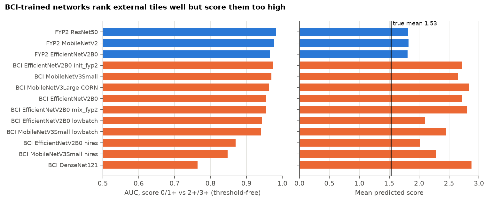
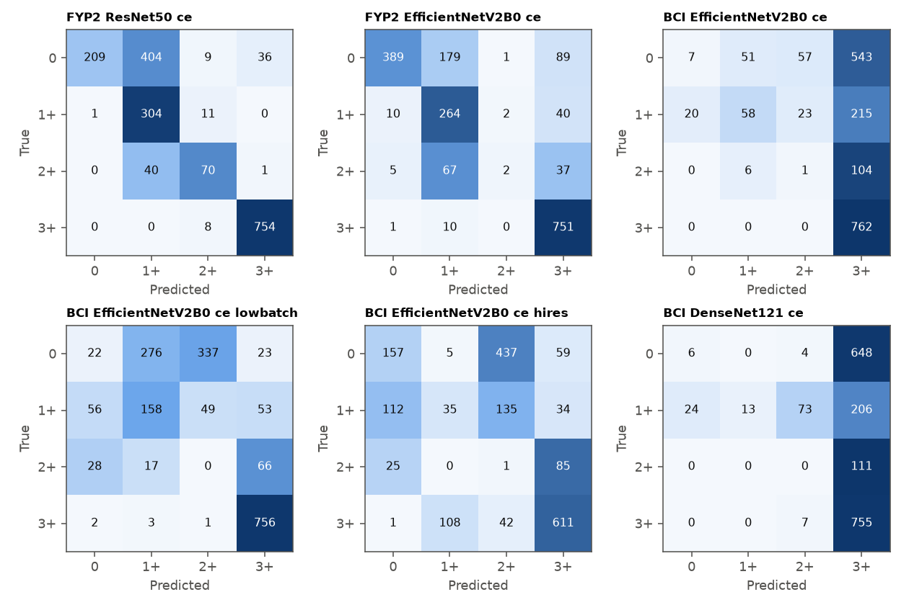
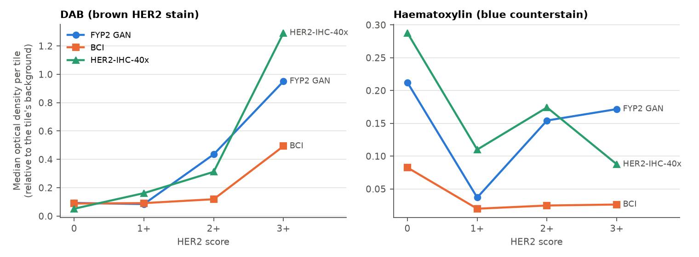
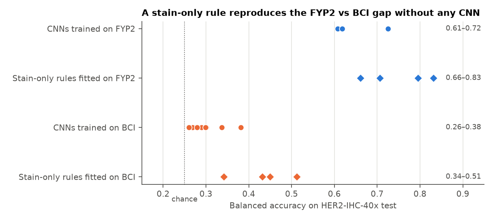
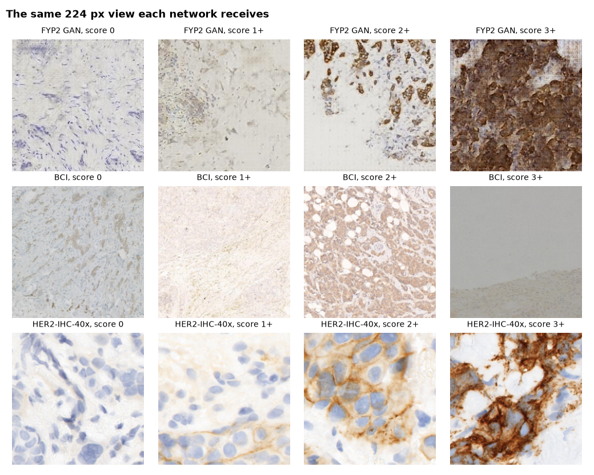

# Cross-dataset audit: why FYP2 beats FYP3 on HER2-IHC-40x

Audit date: 30 Oct 2026. Sources: `results/external/her2_40x/` and `final_reports/tables/`. The external labels were used
only for reporting and diagnosis. Paper facts come from the HER2-IHC-40x dataset article (Data in Brief 2025).

## The question

Networks trained on synthetic GAN images score better on real external tissue than networks trained on real BCI tissue.
That is the opposite of what one would expect.

| Trained on | Run | Input | Acc | Bal. acc | Macro-F1 | QWK | QWK CI (filename runs) | AUC 0/1+ vs 2+/3+ | AUC 3+ vs rest | Spearman | Mean pred. score | Recall 0/1+/2+/3+ |
|---|---|---|---|---|---|---|---|---|---|---|---|---|
| FYP2 | ResNet50 / ce | 224 | 0.724 | 0.725 | 0.673 | 0.856 | [0.80, 0.90] | 0.982 | 0.999 | 0.83 | 1.81 | 0.32 / 0.96 / 0.63 / 0.99 |
| FYP2 | MobileNetV2 / ce | 224 | 0.685 | 0.618 | 0.573 | 0.868 | [0.83, 0.90] | 0.977 | 0.999 | 0.87 | 1.82 | 0.30 / 0.90 / 0.29 / 0.99 |
| FYP2 | EfficientNetV2B0 / ce | 224 | 0.761 | 0.608 | 0.573 | 0.792 | [0.72, 0.85] | 0.966 | 0.992 | 0.85 | 1.81 | 0.59 / 0.83 / 0.02 / 0.99 |
| BCI | EfficientNetV2B0 / ce / lowbatch | 224 | 0.507 | 0.381 | 0.345 | 0.584 | [0.51, 0.66] | 0.943 | 0.989 | 0.74 | 2.10 | 0.03 / 0.50 / 0.00 / 0.99 |
| BCI | MobileNetV3Small / ce / lowbatch | 224 | 0.586 | 0.381 | 0.357 | 0.403 | [0.34, 0.46] | 0.941 | 0.892 | 0.81 | 2.45 | 0.45 / 0.07 / 0.00 / 1.00 |
| BCI | MobileNetV3Small / ce | 224 | 0.508 | 0.337 | 0.301 | 0.210 | [0.15, 0.28] | 0.970 | 0.956 | 0.81 | 2.65 | 0.20 / 0.15 / 0.00 / 1.00 |
| BCI | EfficientNetV2B0 / ce | 224 | 0.448 | 0.301 | 0.235 | 0.108 | [0.07, 0.15] | 0.956 | 0.982 | 0.76 | 2.71 | 0.01 / 0.18 / 0.01 / 1.00 |
| BCI | MobileNetV3Small / ce / hires | 448 | 0.419 | 0.299 | 0.278 | 0.316 | [0.24, 0.40] | 0.848 | 0.798 | 0.60 | 2.29 | 0.12 / 0.28 / 0.00 / 0.79 |
| BCI | EfficientNetV2B0 / ce / hires | 448 | 0.435 | 0.290 | 0.318 | 0.432 | [0.36, 0.51] | 0.870 | 0.859 | 0.57 | 2.01 | 0.24 / 0.11 / 0.01 / 0.80 |
| BCI | EfficientNetV2B0 / ce / mix_fyp2 | 224 | 0.437 | 0.279 | 0.206 | 0.055 | [0.03, 0.09] | 0.956 | 0.984 | 0.76 | 2.81 | 0.03 / 0.07 / 0.02 / 1.00 |
| BCI | EfficientNetV2B0 / ce / init_fyp2 | 224 | 0.424 | 0.268 | 0.204 | 0.166 | [0.12, 0.21] | 0.974 | 0.978 | 0.81 | 2.72 | 0.00 / 0.06 / 0.01 / 1.00 |
| BCI | MobileNetV3Large / corn | 224 | 0.423 | 0.261 | 0.180 | 0.100 | [0.05, 0.15] | 0.964 | 0.945 | 0.80 | 2.83 | 0.02 / 0.03 / 0.00 / 1.00 |
| BCI | DenseNet121 / ce | 224 | 0.419 | 0.260 | 0.176 | 0.032 | [0.01, 0.07] | 0.764 | 0.755 | 0.31 | 2.88 | 0.01 / 0.04 / 0.00 / 0.99 |

*QWK CIs resample filename runs, a partial proxy for the 21 unavailable slide IDs, so they are still optimistic.*

## Answer

**The difference is stain calibration, not better learning.** HER2-IHC-40x stains look like the GAN's and unlike BCI's, and
its classes are close to a stain threshold. A stain-only rule with no CNN reproduces the whole gap and beats every CNN.
**Good external scores here do not show that GAN-trained networks generalise to real tissue.** They fail on BCI
(balanced accuracy 0.30–0.46), and HER2-IHC-40x is not a representative test of real-world generalisation.

## Explanations tested

| Explanation | Test | Verdict |
|---|---|---|
| Pipeline bug (labels, class order, preprocessing, checkpoints) | End-to-end reproduction of 13 networks; cache vs raw; label mapping | **Ruled out** |
| Different image scale | Blob and spectrum measures. FYP2's images and BCI's are both far from the external scale, and FYP2 networks still succeed | **Does not explain the gap**, though the mismatch is large |
| Class-prior shift (BCI has 5% score 0, external 36%) | Oracle diagnostic with the true external prior | **Minor** for most networks (table below) |
| BCI networks lack useful features | Threshold-free ranking | **Mostly ruled out.** 7 of 10 reach AUC ≥ 0.94 for 0/1+ vs 2+/3+. The exceptions are DenseNet121 and the two 448 px runs |
| **Stain calibration** | Same measurements on all three sets; stain-only rules | **Confirmed as the main driver** |

## Evidence

### 1. BCI networks rank tiles well but score them too high

EfficientNetV2B0 (BCI) separates 3+ from the rest with AUC 0.98, yet its QWK is 0.11. Its mean predicted score is 2.71,
against a true 1.53. The confusion matrices show the same thing: most tiles of every class are called 3+.

### 2. External stain resembles the GAN, not BCI

| Dataset | Score | DAB mean | DAB p90 | Haem. mean | Saturation | Background | Sharpness | High-freq. share | Spectrum p90 (cycles/224 px) |
|---|---|---|---|---|---|---|---|---|---|
| BCI | 0 | 0.089 | 0.17 | 0.083 | 10 | 207 | 731 | 0.238 | 64 |
| BCI | 1+ | 0.092 | 0.20 | 0.020 | 13 | 230 | 554 | 0.274 | 69 |
| BCI | 2+ | 0.119 | 0.25 | 0.025 | 12 | 175 | 610 | 0.234 | 65 |
| BCI | 3+ | 0.493 | 1.71 | 0.026 | 38 | 188 | 2279 | 0.162 | 54 |
| FYP2 GAN | 0 | 0.093 | 0.26 | 0.212 | 8 | 212 | 1536 | 0.210 | 64 |
| FYP2 GAN | 1+ | 0.085 | 0.22 | 0.037 | 14 | 213 | 628 | 0.157 | 58 |
| FYP2 GAN | 2+ | 0.435 | 1.01 | 0.154 | 21 | 218 | 2440 | 0.103 | 46 |
| FYP2 GAN | 3+ | 0.951 | 2.09 | 0.172 | 41 | 223 | 2412 | 0.051 | 30 |
| HER2-IHC-40x | 0 | 0.052 | 0.13 | 0.288 | 15 | 241 | 133 | 0.012 | 19 |
| HER2-IHC-40x | 1+ | 0.162 | 0.34 | 0.110 | 21 | 241 | 68 | 0.010 | 15 |
| HER2-IHC-40x | 2+ | 0.312 | 0.78 | 0.174 | 40 | 234 | 254 | 0.017 | 21 |
| HER2-IHC-40x | 3+ | 1.292 | 3.12 | 0.088 | 80 | 239 | 766 | 0.014 | 20 |

External 1+ tiles carry more DAB (0.16) than BCI 2+ tiles (0.12), and external counterstain is 3–7× stronger than BCI's.
A network calibrated on BCI reads such tiles as high-scoring.

### 3. A stain-only rule reproduces the gap

Each rule was fitted on training tiles of one dataset and applied unchanged to the external test tiles.

| Features | Fitted on | Model | Acc | Bal. acc | QWK | Mean pred. |
|---|---|---|---|---|---|---|
| DAB only | BCI train | logistic | 0.438 | 0.341 | 0.483 | 2.40 |
| DAB only | BCI train | random forest | 0.593 | 0.512 | 0.676 | 2.14 |
| DAB only | FYP2 train | logistic | 0.708 | 0.706 | 0.894 | 1.73 |
| DAB only | FYP2 train | random forest | 0.614 | 0.661 | 0.865 | 1.86 |
| DAB + haematoxylin | BCI train | logistic | 0.675 | 0.449 | 0.745 | 2.01 |
| DAB + haematoxylin | BCI train | random forest | 0.554 | 0.432 | 0.481 | 2.34 |
| DAB + haematoxylin | FYP2 train | logistic | 0.892 | 0.831 | 0.959 | 1.54 |
| DAB + haematoxylin | FYP2 train | random forest | 0.826 | 0.795 | 0.942 | 1.62 |

- A logistic rule on six stain numbers, fitted on FYP2, reaches **accuracy 0.89 and QWK 0.96**, better than every CNN in the project.
- The same rule fitted on BCI reaches balanced accuracy 0.45.
- The CNN gap (0.61–0.72 vs 0.26–0.38) is reproduced by rules that know nothing about morphology.

**Interpretation.** The dataset paper describes per-class filtering: patches were kept only if their hue histogram matched 20
reference images of their class. That selects for class-typical colour, which plausibly makes this set unusually easy by
colour. The filter is documented; its causal role is an interpretation.

### 4. Class prior is a small part

| Trained on | Run | Bal. acc | Bal. acc with true target prior | QWK | QWK with true target prior |
|---|---|---|---|---|---|
| FYP2 | ResNet50 / ce | 0.725 | 0.712 | 0.856 | 0.858 |
| FYP2 | MobileNetV2 / ce | 0.618 | 0.588 | 0.868 | 0.842 |
| FYP2 | EfficientNetV2B0 / ce | 0.608 | 0.589 | 0.792 | 0.760 |
| BCI | EfficientNetV2B0 / ce / lowbatch | 0.381 | 0.402 | 0.584 | 0.665 |
| BCI | MobileNetV3Small / ce / lowbatch | 0.381 | 0.413 | 0.403 | 0.508 |
| BCI | MobileNetV3Small / ce | 0.337 | 0.368 | 0.210 | 0.329 |
| BCI | EfficientNetV2B0 / ce | 0.301 | 0.304 | 0.108 | 0.122 |
| BCI | MobileNetV3Small / ce / hires | 0.299 | 0.361 | 0.316 | 0.450 |
| BCI | EfficientNetV2B0 / ce / hires | 0.290 | 0.379 | 0.432 | 0.626 |
| BCI | EfficientNetV2B0 / ce / mix_fyp2 | 0.279 | 0.295 | 0.055 | 0.125 |
| BCI | EfficientNetV2B0 / ce / init_fyp2 | 0.268 | 0.274 | 0.166 | 0.144 |
| BCI | MobileNetV3Large / corn | 0.261 | 0.273 | 0.100 | 0.117 |
| BCI | DenseNet121 / ce | 0.260 | 0.263 | 0.032 | 0.050 |

This uses the true test prior, so it is a diagnostic only and **not a reportable performance**.

### 5. The scale mismatch is large but separate

- At the same 224 px view, external tiles hold a few cells, BCI and GAN tiles hundreds.
- At native 1024 px, on unlabelled development tiles: median blob diameter 43.5 px (IQR 19–51) vs 9.1 px for BCI, a ratio of about **4.8**.
- Spectral content agrees: at 224 px the 90th-percentile frequency is 15–21 cycles against 54–69 for BCI.
- A ratio of 4.8 would imply about 0.10 µm/px, finer than a 40× scan normally gives. The paper says patches were resized to
  1024 px, so upsampling is likely (interpretation). The field size is not documented. The blob measure may merge touching
  cells, so 4.8 is an upper-range estimate. The next experiment tests 2, 3 and 4.8.
- Earlier statements of about 1.8× were based on assumed magnifications and are withdrawn.

## Dataset facts

| | HER2-IHC-40x, WSI-based split |
|---|---|
| Source | One centre (University of Malaya), scanner 3DHistech Pannoramic DESK, 40×; µm/px not reported |
| Slides | 107 WSIs: **86 train, 21 test**, split before patch extraction |
| Tiles | Train 8,093 (3,131 / 1,837 / 523 / 2,602); test 1,847 (658 / 316 / 111 / 762). Counts verified from the archives |
| Labels | **ROI-level**, propagated to patches. Scoring standard and number of raters not stated |
| Curation | Pathologist ROIs, per-class hue-histogram filter, intensity histogram normalisation, patches resized to 1024 px |
| Slide IDs | None. Filename runs are a partial proxy |
| Label oddities | Folder and filename score differ on 10 test and 2 train tiles |
| Patch-based split | Not independent: 1,594 of its test names are in the WSI-based training set. **Do not use it** |

## Limitations

- 21 test slides at most, with no IDs, so all CIs are optimistic.
- 2+ has only 111 tiles, possibly from few slides.
- The Ruifrok–Johnston stain vectors are generic, so stain channels are only approximately separated.
- Each network is one seed. External QWK varies widely across the five EfficientNetV2B0 runs (0.06–0.58).
- The stain comparison uses BCI's grouped test split, whose 3+ tiles stain unusually strongly (median 0.49; 0.25 across train).
  The gap to the external set is therefore, if anything, understated.
