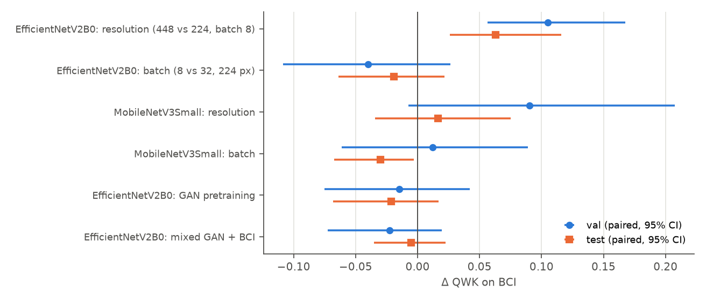

# FYP3 experiment audit

Audit date: 30 Oct 2026. Every number here was recomputed from saved artifacts by the scripts in
`final_reports/scripts/`. Nothing was trained. `results/REPORT.md` (30 Oct, 09:04) was not changed and predates E1–E5.

## Verdict

- **The experiments are sound.** All 40 stored runs reproduce exactly, the splits are clean, class mapping is correct, and
  checkpoints and preprocessing reproduce saved outputs. No bug explains any result.
- **Some earlier conclusions were too strong.** They are corrected in the table at the end, including statements made by
  this project's previous analysis.
- **Open gaps:** the 4 new runs have no overfitting check, `selection.json` is stale, and two run settings were not logged.

## What was checked

| Check | Method | Result |
|---|---|---|
| Metrics | Accuracy, macro-F1 and QWK recomputed from `predictions.npz`, labels taken from the manifests, for 20 grouped + 2 official + 18 FYP2 runs | **Difference 0.0** against every `summary.json`. Labels match the manifests. Probabilities sum to 1 |
| Grouped split | Counts, fragments, md5, pHash | 3,388 / 727 / 758. **0** fragments and **0** exact duplicates cross splits. Near-duplicates to train (pHash ≤ 6): 1 test tile, 0 val tiles; (≤ 12): 15 test, 14 val |
| FYP2 split | Twin groups, md5 | **0** groups and **0** exact duplicates cross splits |
| Class mapping | Filename or folder vs label | BCI: 0 mismatches in 4,873. FYP2: 0 in 2,400. Same 0 / 1+ / 2+ / 3+ order in all networks |
| Checkpoints and preprocessing | 13 external-evaluated networks reloaded on CPU, 24 images each | All reproduce saved test predictions and external probabilities (table below). Cached external tiles equal a fresh resize of the raw file |
| External metrics | Recomputed from the per-tile CSVs | Difference 0.0 against the stored JSON |
| Mixed training leakage | Code review of `fyp2_train_paths()` | Uses FYP2's train split only. FYP2 val and test are never read. BCI val and test are unaffected |
| Deployment | Confusion matrices re-scored; FP32 confusion compared with Keras | Metrics match; FP32 equals Keras on val and test |

| Trained on | Run | Input | Max |Δp| own test | Max |Δp| external | Cache vs fresh resize |
|---|---|---|---|---|---|
| BCI | DenseNet121 / ce | 224 | 5.4e-07 | 1.2e-07 | 0 |
| BCI | EfficientNetV2B0 / ce | 224 | 1.4e-06 | 1.3e-06 | 0 |
| BCI | EfficientNetV2B0 / ce / hires | 448 | 2.4e-07 | 4.2e-07 | 0 |
| BCI | EfficientNetV2B0 / ce / init_fyp2 | 224 | 1.2e-06 | 1.2e-06 | 0 |
| BCI | EfficientNetV2B0 / ce / lowbatch | 224 | 1.4e-06 | 7.5e-07 | 0 |
| BCI | EfficientNetV2B0 / ce / mix_fyp2 | 224 | 1.4e-06 | 7.2e-07 | 0 |
| BCI | MobileNetV3Large / corn | 224 | 1.1e-06 | 4.1e-06 | 0 |
| BCI | MobileNetV3Small / ce | 224 | 3.1e-06 | 3.8e-06 | 0 |
| BCI | MobileNetV3Small / ce / hires | 448 | 2.8e-06 | 7.5e-07 | 0 |
| BCI | MobileNetV3Small / ce / lowbatch | 224 | 3.0e-06 | 2.1e-06 | 0 |
| FYP2 | EfficientNetV2B0 / ce | 224 | 1.2e-07 | 1.7e-06 | 0 |
| FYP2 | MobileNetV2 / ce | 224 | 1.2e-07 | 1.9e-06 | 0 |
| FYP2 | ResNet50 / ce | 224 | 2.3e-12 | 2.9e-07 | 0 |

## E1–E5

The plan's labels: E1 and E2 are the resolution and batch controls, E3 the external test, E4 GAN pretraining, E5 mixed
training. Δ is A − B on the same tiles, with a 95% fragment-cluster bootstrap CI. `*` means the CI excludes 0.

| Effect | A − B | Δ val QWK | Δ val acc | Δ test QWK | Δ test acc |
|---|---|---|---|---|---|
| E1 resolution | EfficientNetV2B0 / ce / hires − lowbatch | +0.105 [+0.056, +0.168] * | +0.083 [+0.051, +0.113] * | +0.063 [+0.026, +0.116] * | +0.070 [+0.042, +0.106] * |
| E1 batch | EfficientNetV2B0 / ce / lowbatch − ce | -0.040 [-0.109, +0.027] | -0.028 [-0.060, +0.007] | -0.019 [-0.064, +0.021] | -0.021 [-0.051, +0.006] |
| E1 combined | EfficientNetV2B0 / ce / hires − ce | +0.065 [+0.026, +0.108] * | +0.055 [+0.033, +0.076] * | +0.044 [+0.009, +0.089] * | +0.049 [+0.028, +0.079] * |
| E2 resolution | MobileNetV3Small / ce / hires − lowbatch | +0.090 [-0.007, +0.207] | +0.041 [+0.000, +0.086] | +0.017 [-0.034, +0.075] | +0.003 [-0.022, +0.031] |
| E2 batch | MobileNetV3Small / ce / lowbatch − ce | +0.012 [-0.061, +0.089] | +0.003 [-0.019, +0.026] | -0.030 [-0.067, -0.003] * | -0.008 [-0.028, +0.010] |
| E2 combined | MobileNetV3Small / ce / hires − ce | +0.102 [+0.031, +0.173] * | +0.044 [+0.012, +0.076] * | -0.014 [-0.063, +0.038] | -0.005 [-0.031, +0.024] |
| E4 init_fyp2 | EfficientNetV2B0 / ce / init_fyp2 − ce | -0.015 [-0.075, +0.042] | +0.007 [-0.018, +0.029] | -0.021 [-0.068, +0.017] | -0.007 [-0.031, +0.022] |
| E5 mix_fyp2 | EfficientNetV2B0 / ce / mix_fyp2 − ce | -0.023 [-0.073, +0.020] | -0.011 [-0.036, +0.014] | -0.005 [-0.035, +0.023] | -0.009 [-0.038, +0.023] |

**Reading the table:**
- **E1 (EfficientNetV2B0): resolution is the cause.** At equal batch size, 448 px beats 224 px on val and test. Batch size has
  no effect (val −0.040, CI includes 0). The caveat in the 30 Oct report is resolved for this model.
- **E2 (MobileNetV3Small): not confirmed.** The resolution effect on val has a CI that includes 0 (+0.090 [−0.007, +0.207]), and
  the test effect is near zero. By the pre-set rule, the resolution effect is confirmed on 1 of 2 models.
- **E4 and E5: no benefit.** Neither GAN pretraining nor mixed GAN + BCI training beats the baseline on BCI val or test.
- **E3:** see `cross_dataset_audit.md`.

## All grouped runs

| Run | Input | Batch | Best / run epochs | Train min | Val acc | Val QWK | Test acc | Test bal. acc | Test QWK |
|---|---|---|---|---|---|---|---|---|---|
| EfficientNetV2B0 / ce / hires | 448 | 8 | 38 / 45 | 252 | 0.950 | 0.935 | 0.975 | 0.973 | 0.959 |
| EfficientNetV2B0 / ce | 224 | 32 | 31 / 41 | 49 | 0.895 | 0.869 | 0.926 | 0.917 | 0.915 |
| MobileNetV3Small / ce / hires | 448 | 8 | 15 / 25 | 45 | 0.898 | 0.865 | 0.908 | 0.898 | 0.874 |
| DenseNet121 / ce | 224 | 16 | 32 / 42 | 131 | 0.908 | 0.854 | 0.942 | 0.922 | 0.910 |
| EfficientNetV2B0 / ce / init_fyp2 | 224 | 32 | 29 / 39 | 55 | 0.902 | 0.854 | 0.920 | 0.919 | 0.894 |
| EfficientNetV2B0 / ce / mix_fyp2 | 224 | 32 | 18 / 28 | 56 | 0.884 | 0.847 | 0.917 | 0.915 | 0.910 |
| EfficientNetB0 / ce | 224 | 32 | 31 / 41 | 111 | 0.891 | 0.846 | 0.933 | 0.914 | 0.902 |
| ConvNeXtTiny / ce | 224 | 16 | 13 / 23 | 124 | 0.902 | 0.844 | 0.926 | 0.891 | 0.898 |
| DenseNet121 / corn | 224 | 16 | 30 / 40 | 143 | 0.880 | 0.841 | 0.914 | 0.893 | 0.874 |
| EfficientNetV2B0 / corn | 224 | 32 | 16 / 26 | 30 | 0.862 | 0.831 | 0.906 | 0.900 | 0.892 |
| EfficientNetV2B0 / ce / lowbatch | 224 | 8 | 16 / 26 | 42 | 0.868 | 0.829 | 0.905 | 0.901 | 0.896 |
| ResNet50 / ce | 224 | 16 | 43 / 45 | 108 | 0.902 | 0.829 | 0.949 | 0.934 | 0.932 |
| MobileNetV3Large / corn | 224 | 32 | 45 / 45 | 47 | 0.894 | 0.825 | 0.937 | 0.919 | 0.923 |
| NASNetMobile / ce | 224 | 32 | 28 / 38 | 100 | 0.884 | 0.805 | 0.921 | 0.895 | 0.904 |
| MobileNetV3Large / ce | 224 | 32 | 22 / 32 | 76 | 0.871 | 0.800 | 0.908 | 0.884 | 0.878 |
| MobileNetV3Small / ce / cw | 224 | 32 | 34 / 44 | 15 | 0.854 | 0.786 | 0.906 | 0.896 | 0.883 |
| MobileNetV2 / ce | 224 | 32 | 33 / 43 | 75 | 0.857 | 0.785 | 0.930 | 0.925 | 0.924 |
| MobileNetV3Small / ce / lowbatch | 224 | 8 | 30 / 40 | 28 | 0.857 | 0.775 | 0.905 | 0.875 | 0.857 |
| MobileNetV3Small / ce / ls | 224 | 32 | 31 / 41 | 16 | 0.864 | 0.767 | 0.905 | 0.868 | 0.873 |
| MobileNetV3Small / ce | 224 | 32 | 34 / 44 | 23 | 0.854 | 0.763 | 0.913 | 0.886 | 0.888 |

## Model selection

`selection.json` was written before E1–E5. The rule was re-applied read-only, top two per tier by val QWK, including all
new runs. **The baseline tier winners do not change.** The best run including improvements in each tier:

| Tier | Run | Params (M) | Val QWK | Val acc | Test QWK | Test acc |
|---|---|---|---|---|---|---|
| heavy | DenseNet121 / ce | 7.04 | 0.854 | 0.908 | 0.910 | 0.942 |
| heavy | ConvNeXtTiny / ce | 27.82 | 0.844 | 0.902 | 0.898 | 0.926 |
| lite | MobileNetV3Small / ce / hires | 0.94 | 0.865 | 0.898 | 0.874 | 0.908 |
| lite | MobileNetV3Large / corn | 3.00 | 0.825 | 0.894 | 0.923 | 0.937 |
| mid | EfficientNetV2B0 / ce / hires | 5.92 | 0.935 | 0.950 | 0.959 | 0.975 |
| mid | EfficientNetV2B0 / ce | 5.92 | 0.869 | 0.895 | 0.915 | 0.926 |

- **Mid tier:** EfficientNetV2B0 at 448 px is the only clear winner.
- **Lite tier:** MobileNetV3Small at 448 px leads on val QWK, but it is within noise of MobileNetV3Large CORN (+0.040
  [−0.059, +0.157]) and has lower test QWK.
- **Heavy tier:** no 448 px run exists, so the tiers are not compared on equal terms.

## Findings to act on

| # | Severity | Finding | Action |
|---|---|---|---|
| 1 | Medium | The 4 new runs are missing from `metrics_all.csv`, `overfitting.csv`, `selection.json` and `REPORT.md`. They have **no train-accuracy or overfitting verdict** | Run `evaluate_all.py` after copying the aggregates, because it rewrites them (`ANTIGRAVITY_HANDOFF.md`, optional) |
| 2 | Medium | External CIs resample tiles, but the test split has only 21 slides and no slide IDs. Filename runs (370) are a partial proxy and still over-count slides | Treat external CIs as optimistic. Do not quote the tile CIs alone |
| 3 | Medium | The external test labels have now been seen in diagnostics, including this audit. It is no longer strictly unseen | Disclosed. Next-experiment parameters come only from the 86 development slides |
| 4 | Low | `mix_fyp2` used a non-default FT epoch ceiling that is not stored. The learning-rate curve implies 26 (26 × 158 = 4,108 steps vs 40 × 105 = 4,200 at baseline, a fair budget match). `run_variants.sh` cannot pass this option, so the command is unlogged | Record such options in `summary.json` in future |
| 5 | Low | `deploy.py` was edited at 17:57, after its outputs (15:44), and there is no deploy log | Metrics were re-verified, but the INT8 file cannot be tied to the current code |
| 6 | Low | The first E1 run deadlocked (log kept as `train_EfficientNetV2B0__ce__lowbatch_deadlocked_run1.log`). The reported run is the clean rerun | None |
| 7 | Low | Single seed per arm. Bootstrap CIs cover tile sampling, not training variance | State this wherever single-run differences are quoted |
| 8 | Low | Many comparisons were made without correction. The E2 batch test-QWK CI excludes 0 (−0.030), but val shows nothing | Treat as noise; decisions use val |
| 10 | Info | One FYP2 file changed after FYP3 began: `FYP2/pi/README.md` (30 Oct, 10:06) has four extra spaces before its title; a diff against the Pi bundle's copy shows nothing else. This audit did not make that change and left it as it is | Harmless. Remove the spaces if you wish |
| 9 | Info | BCI's grouped test split has **3+ tiles with about twice the DAB of train and val**: median 0.49 vs 0.25 and 0.23 | Likely contributes to test > val on every model (interpretation). Quote both splits |

## Corrected conclusions

| Earlier statement | Corrected |
|---|---|
| "Higher input resolution helps", confirmed on two models | Confirmed as a **resolution** effect on EfficientNetV2B0 only. On MobileNetV3Small the hires gain on val is real, but its resolution-only CI includes 0 and test shows no gain |
| The hires gain might be a batch-size effect | Not supported on either model: the batch-size CIs on val include 0 |
| "FYP2 models generalise better to real tissue" (a tempting reading of E3) | **Misleading.** They fail on BCI and succeed on HER2-IHC-40x because that set's stain resembles the GAN's. See `cross_dataset_audit.md` |
| Low batch improves external performance (QWK 0.58 vs 0.11) | **Misleading.** Ranking is the same (Spearman 0.74 vs 0.76). The gap is a calibration difference between two single training runs |
| Double resolution is the best model overall | Best on BCI only. It **lowers** external ranking (AUC 0.87 vs 0.96) |
| HER2-IHC-40x tiles are about 1.8× larger in scale than BCI | Measured ratio is about **4–5×** and uncertain: the paper says patches were resized to 1024 px |
| Whether HER2-IHC-40x labels are slide- or tile-level is unknown | Resolved from the paper: **ROI-level labels, propagated to patches** |
| `REPORT_CORRECTIONS.md` #2–3 (hires cause untested) | Superseded by E1/E2 as above |

All tables are in `final_reports/tables/`.
