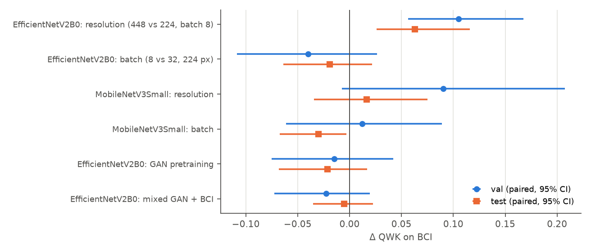
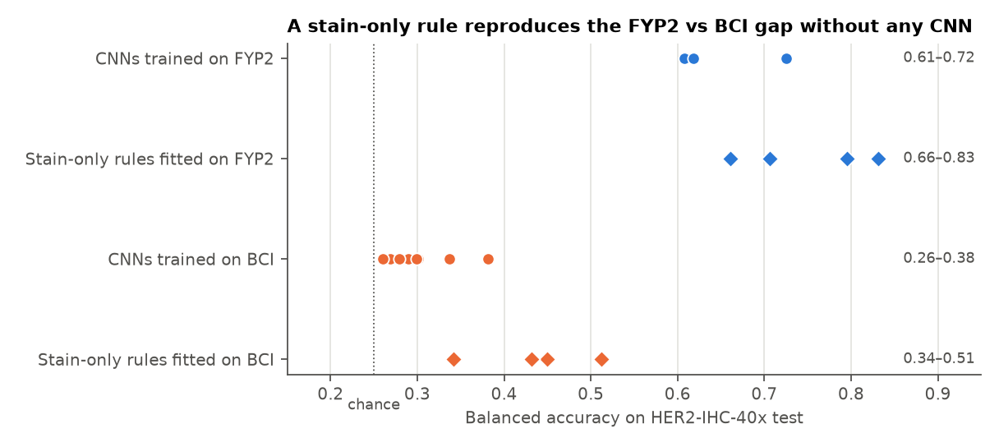

# FYP3 final technical report

> **Historical record; read with corrections (added 10 Nov 2026).** This file is kept unchanged as a log of the work at the time it was written. Some statements in it were later found to be wrong or unsupported (for example: phone "throttled=0x0" flags, a Pi INT8 latency that was never measured, energy/per-watt claims, the DAB mechanism for the 448 px collapse, and several Table 1/2 values). The authoritative versions are `FYP3_FINAL_REPORT.md` (revised 10 Nov 2026), `experiments_v2/README.md`, and the itemised list in `experiments_v2/REPORT_CORRECTIONS_v2.md`.

Updated 30 Oct 2026. Covers E1–E5, the external test, HARMONISE-1, HARMONISE-2, quantisation and model selection. The earlier version is kept in
`archive/final_fyp3_report_before_harmonise.md`, and `results/REPORT.md` is preserved for its detailed evidence. Findings are marked **confirmed** (measured) or **interpretation**.

## Required disclosures

1. **No clinical validation.** Nothing here has been tested in a clinical setting or against an independent reference standard. The models are research software.
2. **Genuine WSI identifiers are unavailable.** Neither BCI nor HER2-IHC-40x provides slide or patient IDs for tiles. No per-slide or per-patient result exists. Slide fragments (BCI) and index blocks (HER2-IHC-40x) are reconstructions, not verified slides.
3. **The external test set has been exposed.** Its labels were used for diagnostics, including the stain analysis that motivated HARMONISE-1, before calibration was fitted. It was then evaluated once for HARMONISE-1. It is not a pristine test set, and its CIs are optimistic.
4. **Borderline HER2 performance remains weak.** Across domains, 1+ and 2+ are poorly detected (section 6). On BCI, high 2+ scores reflect slide-level labels (section 8).
5. **No Raspberry Pi benchmark exists.** All latency figures are Mac CPU. A benchmark protocol and scripts are prepared, not run on a Pi.

## Summary

1. **BCI.** The FYP2 pipeline drops from about 100% test accuracy on GAN images to 91–95% on BCI at 224 px. EfficientNetV2B0 at 448 px reaches 0.975 test accuracy and val QWK 0.935, the best BCI result.
2. **What worked.** Higher resolution, as a confirmed resolution effect on EfficientNetV2B0 only. Class weights, label smoothing, CORN, GAN pretraining and mixed training gave no gain.
3. **External generalisation failed without calibration.** On HER2-IHC-40x, BCI-trained models reach 0.42–0.59 accuracy. The primary model reaches 0.435.
4. **HARMONISE-1.** One fixed stain calibration raised balanced accuracy of the 224 px EfficientNetV2B0 by +0.202, to 0.503. It failed for the 448 px model.
5. **HARMONISE-2.** The gains are stable to tile sampling, but borderline classes remain weak and confidence cannot safely flag them. Slide-level analysis was not possible.
6. **Selection.** Primary: EfficientNetV2B0 448 px FP16, for BCI-like tiles. Experimental only: EfficientNetV2B0 224 px with frozen stain calibration, for HER2-IHC-40x. They are kept separate.

## 1. Data and method

| | FYP2 | BCI (FYP3) | HER2-IHC-40x |
|---|---|---|---|
| Nature | CGAN images, HER2SC-derived | Real IHC | Real IHC |
| Native size | 256 px | 1024 px, 0.46 µm/px | 1024 px; µm/px unknown |
| Volume | 2,400 | 4,873 tiles, 51 WSI pairs (BCI paper) | 9,940 tiles, 107 WSIs |
| Labels | Generator class | Slide-level | ROI-level, propagated to patches |
| Split | 70/15/15 by twin group | 70/15/15 by reconstructed slide fragment | 86 development / 21 test WSIs, by the publishers |

All models used FYP2's schedule: two-stage training, frozen BatchNorm, seed 42, early stopping on val QWK. Decisions used validation. Paired CIs resample slide fragments on BCI.

## 2. Results on BCI, including E1, E2, E4, E5

| Run | Input | Batch | Best / run epochs | Train min | Val acc | Val QWK | Test acc | Test bal. acc | Test QWK |
|---|---|---|---|---|---|---|---|---|---|
| EfficientNetV2B0 / ce / hires | 448 | 8 | 38 / 45 | 252 | 0.950 | 0.935 | 0.975 | 0.973 | 0.959 |
| EfficientNetV2B0 / ce | 224 | 32 | 31 / 41 | 49 | 0.895 | 0.869 | 0.926 | 0.917 | 0.915 |
| MobileNetV3Small / ce / hires | 448 | 8 | 15 / 25 | 45 | 0.898 | 0.865 | 0.908 | 0.898 | 0.874 |
| DenseNet121 / ce | 224 | 16 | 32 / 42 | 131 | 0.908 | 0.854 | 0.942 | 0.922 | 0.910 |
| EfficientNetV2B0 / ce / init_fyp2 | 224 | 32 | 29 / 39 | 55 | 0.902 | 0.854 | 0.920 | 0.919 | 0.894 |
| EfficientNetV2B0 / ce / mix_fyp2 | 224 | 32 | 18 / 28 | 56 | 0.884 | 0.847 | 0.917 | 0.915 | 0.910 |
| EfficientNetB0 / ce | 224 | 32 | 31 / 41 | 111 | 0.891 | 0.846 | 0.933 | 0.914 | 0.902 |
| ConvNeXtTiny / ce | 224 | 16 | 13 / 23 | 124 | 0.902 | 0.844 | 0.926 | 0.891 | 0.898 |
| DenseNet121 / corn | 224 | 16 | 30 / 40 | 143 | 0.880 | 0.841 | 0.914 | 0.893 | 0.874 |
| EfficientNetV2B0 / corn | 224 | 32 | 16 / 26 | 30 | 0.862 | 0.831 | 0.906 | 0.900 | 0.892 |
| EfficientNetV2B0 / ce / lowbatch | 224 | 8 | 16 / 26 | 42 | 0.868 | 0.829 | 0.905 | 0.901 | 0.896 |
| ResNet50 / ce | 224 | 16 | 43 / 45 | 108 | 0.902 | 0.829 | 0.949 | 0.934 | 0.932 |
| MobileNetV3Large / corn | 224 | 32 | 45 / 45 | 47 | 0.894 | 0.825 | 0.937 | 0.919 | 0.923 |
| NASNetMobile / ce | 224 | 32 | 28 / 38 | 100 | 0.884 | 0.805 | 0.921 | 0.895 | 0.904 |
| MobileNetV3Large / ce | 224 | 32 | 22 / 32 | 76 | 0.871 | 0.800 | 0.908 | 0.884 | 0.878 |
| MobileNetV3Small / ce / cw | 224 | 32 | 34 / 44 | 15 | 0.854 | 0.786 | 0.906 | 0.896 | 0.883 |
| MobileNetV2 / ce | 224 | 32 | 33 / 43 | 75 | 0.857 | 0.785 | 0.930 | 0.925 | 0.924 |
| MobileNetV3Small / ce / lowbatch | 224 | 8 | 30 / 40 | 28 | 0.857 | 0.775 | 0.905 | 0.875 | 0.857 |
| MobileNetV3Small / ce / ls | 224 | 32 | 31 / 41 | 16 | 0.864 | 0.767 | 0.905 | 0.868 | 0.873 |
| MobileNetV3Small / ce | 224 | 32 | 34 / 44 | 23 | 0.854 | 0.763 | 0.913 | 0.886 | 0.888 |

| Effect | A − B | Δ val QWK | Δ val acc | Δ test QWK | Δ test acc |
|---|---|---|---|---|---|
| E1 resolution | EfficientNetV2B0 / ce / hires − lowbatch | +0.105 [+0.056, +0.168] * | +0.083 [+0.051, +0.113] * | +0.063 [+0.026, +0.116] * | +0.070 [+0.042, +0.106] * |
| E1 batch | EfficientNetV2B0 / ce / lowbatch − ce | -0.040 [-0.109, +0.027] | -0.028 [-0.060, +0.007] | -0.019 [-0.064, +0.021] | -0.021 [-0.051, +0.006] |
| E1 combined | EfficientNetV2B0 / ce / hires − ce | +0.065 [+0.026, +0.108] * | +0.055 [+0.033, +0.076] * | +0.044 [+0.009, +0.089] * | +0.049 [+0.028, +0.079] * |
| E2 resolution | MobileNetV3Small / ce / hires − lowbatch | +0.090 [-0.007, +0.207] | +0.041 [+0.000, +0.086] | +0.017 [-0.034, +0.075] | +0.003 [-0.022, +0.031] |
| E2 batch | MobileNetV3Small / ce / lowbatch − ce | +0.012 [-0.061, +0.089] | +0.003 [-0.019, +0.026] | -0.030 [-0.067, -0.003] * | -0.008 [-0.028, +0.010] |
| E2 combined | MobileNetV3Small / ce / hires − ce | +0.102 [+0.031, +0.173] * | +0.044 [+0.012, +0.076] * | -0.014 [-0.063, +0.038] | -0.005 [-0.031, +0.024] |
| E4 init_fyp2 | EfficientNetV2B0 / ce / init_fyp2 − ce | -0.015 [-0.075, +0.042] | +0.007 [-0.018, +0.029] | -0.021 [-0.068, +0.017] | -0.007 [-0.031, +0.022] |
| E5 mix_fyp2 | EfficientNetV2B0 / ce / mix_fyp2 − ce | -0.023 [-0.073, +0.020] | -0.011 [-0.036, +0.014] | -0.005 [-0.035, +0.023] | -0.009 [-0.038, +0.023] |

*`*`: CI excludes 0. A − B on the same tiles.*

- **E1 (EfficientNetV2B0):** the resolution effect is confirmed on val and test. Batch size has no effect.
- **E2 (MobileNetV3Small):** resolution is not confirmed (val CI includes 0, test near zero).
- **E4 and E5:** GAN pretraining and mixed training gave no gain.
- **Heavy models** were never tested at 448 px.

## 3. Overfitting

On the 16 runs evaluated, train − test accuracy is 2.2–6.6 points against ≤ 0.7 on FYP2. Selection did not overfit validation: val is below test on every run. Noise-aware verdict: 8 overfit, 7 mild, 1 none. The primary model is "mild" (gap 2.4 points, log-loss gap 0.088). **The four E1, E2, E4 and E5 runs have no verdict.** The role of label noise is an interpretation.

## 4. External test without calibration (E3)

| Trained on | Run | Input | Acc | Bal. acc | Macro-F1 | QWK | QWK CI (filename runs) | AUC 0/1+ vs 2+/3+ | AUC 3+ vs rest | Spearman | Mean pred. score | Recall 0/1+/2+/3+ |
|---|---|---|---|---|---|---|---|---|---|---|---|---|
| FYP2 | ResNet50 / ce | 224 | 0.724 | 0.725 | 0.673 | 0.856 | [0.80, 0.90] | 0.982 | 0.999 | 0.83 | 1.81 | 0.32 / 0.96 / 0.63 / 0.99 |
| FYP2 | MobileNetV2 / ce | 224 | 0.685 | 0.618 | 0.573 | 0.868 | [0.83, 0.90] | 0.977 | 0.999 | 0.87 | 1.82 | 0.30 / 0.90 / 0.29 / 0.99 |
| FYP2 | EfficientNetV2B0 / ce | 224 | 0.761 | 0.608 | 0.573 | 0.792 | [0.72, 0.85] | 0.966 | 0.992 | 0.85 | 1.81 | 0.59 / 0.83 / 0.02 / 0.99 |
| BCI | EfficientNetV2B0 / ce / lowbatch | 224 | 0.507 | 0.381 | 0.345 | 0.584 | [0.51, 0.66] | 0.943 | 0.989 | 0.74 | 2.10 | 0.03 / 0.50 / 0.00 / 0.99 |
| BCI | MobileNetV3Small / ce / lowbatch | 224 | 0.586 | 0.381 | 0.357 | 0.403 | [0.34, 0.46] | 0.941 | 0.892 | 0.81 | 2.45 | 0.45 / 0.07 / 0.00 / 1.00 |
| BCI | MobileNetV3Small / ce | 224 | 0.508 | 0.337 | 0.301 | 0.210 | [0.15, 0.28] | 0.970 | 0.956 | 0.81 | 2.65 | 0.20 / 0.15 / 0.00 / 1.00 |
| BCI | EfficientNetV2B0 / ce | 224 | 0.448 | 0.301 | 0.235 | 0.108 | [0.07, 0.15] | 0.956 | 0.982 | 0.76 | 2.71 | 0.01 / 0.18 / 0.01 / 1.00 |
| BCI | MobileNetV3Small / ce / hires | 448 | 0.419 | 0.299 | 0.278 | 0.316 | [0.24, 0.40] | 0.848 | 0.798 | 0.60 | 2.29 | 0.12 / 0.28 / 0.00 / 0.79 |
| BCI | EfficientNetV2B0 / ce / hires | 448 | 0.435 | 0.290 | 0.318 | 0.432 | [0.36, 0.51] | 0.870 | 0.859 | 0.57 | 2.01 | 0.24 / 0.11 / 0.01 / 0.80 |
| BCI | EfficientNetV2B0 / ce / mix_fyp2 | 224 | 0.437 | 0.279 | 0.206 | 0.055 | [0.03, 0.09] | 0.956 | 0.984 | 0.76 | 2.81 | 0.03 / 0.07 / 0.02 / 1.00 |
| BCI | EfficientNetV2B0 / ce / init_fyp2 | 224 | 0.424 | 0.268 | 0.204 | 0.166 | [0.12, 0.21] | 0.974 | 0.978 | 0.81 | 2.72 | 0.00 / 0.06 / 0.01 / 1.00 |
| BCI | MobileNetV3Large / corn | 224 | 0.423 | 0.261 | 0.180 | 0.100 | [0.05, 0.15] | 0.964 | 0.945 | 0.80 | 2.83 | 0.02 / 0.03 / 0.00 / 1.00 |
| BCI | DenseNet121 / ce | 224 | 0.419 | 0.260 | 0.176 | 0.032 | [0.01, 0.07] | 0.764 | 0.755 | 0.31 | 2.88 | 0.01 / 0.04 / 0.00 / 0.99 |

- **No pipeline bug:** 13 of 13 networks reproduced end to end.
- **Stain style explains why GAN-trained networks beat BCI-trained ones.** A stain-only rule fitted on FYP2 reaches accuracy 0.89 and QWK 0.96, better than any CNN. This is not evidence that GAN training generalises: the same networks fail on BCI. See `cross_dataset_audit.md`.
- **BCI networks mostly rank tiles well but score them too high.**

## 5. HARMONISE-1: frozen stain calibration

One haematoxylin gain and one DAB gain for the whole external domain, fitted on unlabelled development tiles against BCI training tiles. `stain_p99` was selected on 2,000 labelled development tiles and evaluated once on test: g_h 0.2545, g_d 0.5045.

- **Endpoint met:** Δ balanced accuracy +0.202 for EfficientNetV2B0 224 px (CI [+0.147, +0.258]), from 0.301 to 0.503. The CI resamples filename runs, not slides, and is optimistic.
- **Scale correction alone did not help.**
- **The 448 px model collapsed** (balanced accuracy 0.290 → 0.186).

## 6. HARMONISE-2: reliability

All on 4,593 development tiles unused by HARMONISE-1, from the same 86 slides. The test split was not read. Every stored result was independently recomputed from saved probabilities and reproduces exactly.

| Model | Split | Arm | Acc | Bal. acc | Macro-F1 | QWK | Recall 0/1+/2+/3+ | Precision 2+ | F1 1+ | F1 2+ |
|---|---|---|---|---|---|---|---|---|---|---|
| EfficientNetV2B0 224 | dev | raw | 0.367 | 0.295 | 0.204 | 0.082 | 0.01 / 0.17 / 0.00 / 1.00 | 0.00 | 0.26 | 0.00 |
| EfficientNetV2B0 224 | dev | stain_p99 | 0.497 | 0.517 | 0.429 | 0.525 | 0.26 / 0.16 / 0.67 / 0.97 | 0.11 | 0.23 | 0.18 |
| EfficientNetV2B0 224 | test | raw | 0.448 | 0.301 | 0.235 | 0.108 | 0.01 / 0.18 / 0.01 / 1.00 | 0.01 | 0.27 | 0.01 |
| EfficientNetV2B0 224 | test | stain_p99 | 0.571 | 0.503 | 0.448 | 0.593 | 0.30 / 0.18 / 0.57 / 0.97 | 0.09 | 0.24 | 0.16 |
| MobileNetV3Small 224 | dev | raw | 0.379 | 0.288 | 0.198 | 0.117 | 0.13 / 0.03 / 0.00 / 1.00 | 0.00 | 0.05 | 0.00 |
| MobileNetV3Small 224 | dev | stain_p99 | 0.717 | 0.539 | 0.507 | 0.799 | 0.93 / 0.14 / 0.09 / 1.00 | 0.25 | 0.23 | 0.14 |
| MobileNetV3Small 224 | test | raw | 0.508 | 0.337 | 0.301 | 0.210 | 0.19 / 0.15 / 0.00 / 1.00 | 0.00 | 0.24 | 0.00 |
| MobileNetV3Small 224 | test | stain_p99 | 0.755 | 0.528 | 0.516 | 0.802 | 0.89 / 0.14 / 0.09 / 0.99 | 0.29 | 0.22 | 0.14 |
| MobileNetV3Large CORN 224 | dev | raw | 0.329 | 0.254 | 0.147 | 0.109 | 0.01 / 0.00 / 0.00 / 1.00 | 0.00 | 0.00 | 0.00 |
| MobileNetV3Large CORN 224 | dev | stain_p99 | 0.543 | 0.429 | 0.404 | 0.409 | 0.44 / 0.22 / 0.07 / 0.99 | 0.07 | 0.31 | 0.07 |
| MobileNetV3Large CORN 224 | test | raw | 0.423 | 0.261 | 0.180 | 0.100 | 0.02 / 0.03 / 0.00 / 1.00 | 0.00 | 0.05 | 0.00 |
| MobileNetV3Large CORN 224 | test | stain_p99 | 0.600 | 0.431 | 0.424 | 0.405 | 0.39 / 0.35 / 0.01 / 0.97 | 0.01 | 0.43 | 0.01 |
| DenseNet121 224 | dev | raw | 0.332 | 0.255 | 0.136 | 0.025 | 0.02 / 0.00 / 0.00 / 1.00 | 0.00 | 0.00 | 0.00 |
| DenseNet121 224 | dev | stain_p99 | 0.627 | 0.447 | 0.404 | 0.758 | 0.96 / 0.01 / 0.04 / 0.78 | 0.08 | 0.02 | 0.05 |
| DenseNet121 224 | test | raw | 0.419 | 0.260 | 0.176 | 0.032 | 0.01 / 0.04 / 0.00 / 0.99 | 0.00 | 0.08 | 0.00 |
| DenseNet121 224 | test | stain_p99 | 0.624 | 0.410 | 0.382 | 0.765 | 0.94 / 0.00 / 0.00 / 0.70 | 0.00 | 0.00 | 0.00 |
| EfficientNetV2B0 448 | dev | raw | 0.344 | 0.266 | 0.259 | 0.350 | 0.20 / 0.02 / 0.04 / 0.80 | 0.01 | 0.04 | 0.01 |
| EfficientNetV2B0 448 | dev | stain_p99 | 0.149 | 0.246 | 0.153 | -0.027 | 0.04 / 0.09 / 0.63 / 0.22 | 0.06 | 0.11 | 0.11 |
| EfficientNetV2B0 448 | test | raw | 0.435 | 0.290 | 0.318 | 0.432 | 0.24 / 0.11 / 0.01 / 0.80 | 0.00 | 0.15 | 0.00 |
| EfficientNetV2B0 448 | test | stain_p99 | 0.104 | 0.186 | 0.108 | -0.155 | 0.05 / 0.15 / 0.47 / 0.08 | 0.04 | 0.13 | 0.08 |

### A. Calibration stability: stable to tile sampling

- At n = 1,500: CV 0.042 (g_d) and 0.030 (g_h). The smallest sample meeting the pre-set limit of 0.10 is 1,000 tiles.
- Across 8 parameter sets, balanced accuracy varies by 0.005 (EfficientNetV2B0) and 0.018 (MobileNetV3Small).
- **p99 is not a fragile edge:** balanced accuracy is flat from p97 to p99.5 (0.494–0.506). But 3+ recall changes from 0.73 to 0.97 across that range, so the flat summary hides a trade-off.
- **Class mix matters:**

| 3+ share in fit sample | g_d | Bal. acc | Recall 0 | Recall 2+ | Recall 3+ |
|---|---|---|---|---|---|
| 0.05 | 0.746 | 0.414 | 0.15 | 0.38 | 0.97 |
| 0.15 | 0.557 | 0.485 | 0.25 | 0.52 | 0.97 |
| 0.3 | 0.492 | 0.504 | 0.29 | 0.55 | 0.96 |
| 0.5 | 0.452 | 0.509 | 0.30 | 0.53 | 0.94 |

A site with few 3+ tiles gets a higher gain and loses about 0.09 balanced accuracy, with no change in staining.

**Limit:** this measures tile sampling within one centre, not site-to-site stability.

### B. WSI-level generalisation: not possible

No slide identifiers exist, so no per-slide result can be produced. The only genuine slide boundary is 86 development vs 21 test WSIs: primary-model balanced accuracy is 0.51 on development selection tiles and 0.50 on test.

An exploratory 5-fold check on filename index blocks gave balanced accuracy 0.44–0.58, and 2+ recall 0.19–0.79. Index blocks are **not** slides. This spread is far wider than the 0.005 from tile resampling, which suggests (interpretation) that heterogeneity between tissue regions is much larger than the stability figures imply.

### C. Class-wise reliability: borderline classes are weak

- **QWK hides class failure.** DenseNet121 has QWK 0.76 with 1+ recall 0.01 and 2+ recall 0.04. MobileNetV3Small has 0.80 with 2+ recall 0.09.
- **Only EfficientNetV2B0 finds 2+** (recall 0.57 test, 0.67 dev), with precision 0.09–0.11. About 9 in 10 tiles it calls 2+ are not 2+.
- **1+ recall is at most 0.35 on any model** on test, and 0.16–0.18 for EfficientNetV2B0.
- **Calibration can harm a class:** DenseNet121's 3+ recall fell from 1.00 to 0.78 on development tiles.

### D. Why the 448 px model fails

| Tiles | Input | Arm | Bal. acc | QWK | Recall 3+ | Recall 2+ | Mean score |
|---|---|---|---|---|---|---|---|
| HER2-IHC-40x dev | 224 | raw | 0.300 | 0.084 | 0.997 | 0.000 | 2.71 |
| HER2-IHC-40x dev | 224 | DAB gain only | 0.319 | 0.135 | 0.995 | 0.012 | 2.57 |
| HER2-IHC-40x dev | 224 | Haematoxylin gain only | 0.334 | 0.388 | 0.929 | 0.183 | 2.20 |
| HER2-IHC-40x dev | 224 | Both (stain_p99) | 0.504 | 0.527 | 0.964 | 0.524 | 1.99 |
| HER2-IHC-40x dev | 448 | raw | 0.279 | 0.381 | 0.849 | 0.024 | 1.94 |
| HER2-IHC-40x dev | 448 | DAB gain only | 0.267 | 0.331 | 0.852 | 0.085 | 1.99 |
| HER2-IHC-40x dev | 448 | Haematoxylin gain only | 0.214 | -0.022 | 0.266 | 0.378 | 2.06 |
| HER2-IHC-40x dev | 448 | Both (stain_p99) | 0.228 | 0.037 | 0.307 | 0.500 | 1.99 |
| BCI val | 224 | raw | 0.875 | 0.869 | 0.864 | 0.938 | 1.95 |
| BCI val | 224 | DAB gain only | 0.669 | 0.618 | 0.500 | 0.857 | 1.79 |
| BCI val | 224 | Haematoxylin gain only | 0.565 | 0.532 | 0.768 | 0.832 | 2.12 |
| BCI val | 224 | Both (stain_p99) | 0.407 | 0.299 | 0.510 | 0.713 | 2.05 |
| BCI val | 448 | raw | 0.945 | 0.935 | 0.924 | 0.975 | 1.94 |
| BCI val | 448 | DAB gain only | 0.780 | 0.743 | 0.737 | 0.854 | 1.79 |
| BCI val | 448 | Haematoxylin gain only | 0.548 | 0.494 | 0.702 | 0.826 | 2.02 |
| BCI val | 448 | Both (stain_p99) | 0.344 | 0.205 | 0.460 | 0.785 | 2.17 |

- **Haematoxylin gain is the cause (confirmed on development tiles).** DAB gain alone leaves 3+ recall at 0.85. Haematoxylin gain alone cuts it to 0.27.
- **Not a resolution-of-fit problem:** gains fitted at 256 and 448 px are nearly identical (g_d 0.485 vs 0.492), and refitted gains do not help.
- **Not simply greater stain sensitivity:** on BCI validation tiles both networks collapse under these gains, and the 448 px one is less sensitive to DAB alone.
- **Scale compensation helps partly:** balanced accuracy rises to 0.322, but 3+ recall falls to 0.70, which fails the pre-set rule.
- **On the 224 px network the two gains work only together:** balanced accuracy is 0.32 with DAB alone, 0.33 with haematoxylin alone, 0.50 with both.
- **The gains are not safe on BCI itself:** balanced accuracy falls from 0.875 to 0.407.

Why the 448 px network depends on the external counterstain in this way was not tested.

### E. Confidence: better calibrated, not usable for review

- ECE falls from 0.56 to 0.26 with calibration, and to 0.10 with temperature scaling (T = 2.84, EfficientNetV2B0). Temperatures differ widely between networks (2.1–5.3) and need target labels to fit.
- Reference ECE on BCI validation is 0.03–0.06.
- **No configuration met the rule for review flagging.** Keeping confident tiles raises accuracy, but it removes the very cases that matter: at 50% target coverage, 76% of true 2+ tiles (EfficientNetV2B0) and 94% (MobileNetV3Small) are referred.
- Tiles whose class flips between calibration samples are wrong more often (0.69 vs 0.49).

## 7. Quantisation

| Variant | Split | Status | Size MB | Mac CPU ms | Acc | Bal. acc | QWK | Recall 0/1+/2+/3+ |
|---|---|---|---|---|---|---|---|---|
| fp32 | val | ok | 22.36 | 71.3 | 0.950 | 0.945 | 0.935 | 0.94 / 0.94 / 0.97 / 0.92 |
| fp32 | test | ok | 22.36 | 71.3 | 0.975 | 0.973 | 0.959 | 0.97 / 0.96 / 0.98 / 0.98 |
| fp16 | val | ok | 11.27 | 75.5 | 0.950 | 0.945 | 0.935 | 0.94 / 0.94 / 0.97 / 0.92 |
| fp16 | test | ok | 11.27 | 75.5 | 0.975 | 0.973 | 0.959 | 0.97 / 0.96 / 0.98 / 0.98 |
| int8 | val | degraded | 6.82 | 133.5 | 0.919 | 0.910 | 0.870 | 0.92 / 0.88 / 0.97 / 0.87 |
| int8 | test | degraded | 6.82 | 133.5 | 0.933 | 0.932 | 0.907 | 0.97 / 0.85 / 0.97 / 0.93 |

FP16 gives confusion matrices identical to FP32. INT8 falls below the agreement threshold (0.928 vs 0.95) and is rejected. Latency is Mac CPU only. See `quantization_deployment.md`.

**FP16 re-validated through the deployment code (Mac):**
- Primary: 100% class agreement with Keras on all 1,485 BCI validation and test tiles; largest probability change 0.020; accuracy reproduced (0.950, 0.975).
- Experimental (a new FP16 export): 99.6% agreement on 2,402 development tiles; largest probability change 0.014. The disagreements examined were near-ties.

## 8. Model selection

**Primary, for BCI-like tiles:** EfficientNetV2B0 448 px FP16. **Experimental, for HER2-IHC-40x only:** EfficientNetV2B0 224 px with frozen `stain_p99`. Full reasoning is in `FINAL_MODEL_SELECTION.md`.

| Split | Score | Tiles | Recall | Precision | F1 |
|---|---|---|---|---|---|
| BCI val | 0 | 36 | 0.944 | 0.971 | 0.958 |
| BCI val | 1+ | 172 | 0.936 | 0.947 | 0.942 |
| BCI val | 2+ | 321 | 0.975 | 0.943 | 0.959 |
| BCI val | 3+ | 198 | 0.924 | 0.963 | 0.943 |
| BCI test | 0 | 36 | 0.972 | 0.946 | 0.959 |
| BCI test | 1+ | 173 | 0.960 | 0.982 | 0.971 |
| BCI test | 2+ | 323 | 0.981 | 0.981 | 0.981 |
| BCI test | 3+ | 226 | 0.978 | 0.965 | 0.971 |

These figures use slide-level labels. Against third-party patch labels:

| Split | Slide label | Tiles with patch label | Patch label agrees with slide label | Model agrees with slide label | Model agrees with patch label |
|---|---|---|---|---|---|
| BCI val | 0 | 14 | 0.643 | 0.929 | 0.714 |
| BCI val | 1+ | 120 | 0.950 | 0.975 | 0.925 |
| BCI val | 2+ | 234 | 0.697 | 0.991 | 0.697 |
| BCI val | 3+ | 121 | 0.959 | 0.983 | 0.959 |
| BCI test | 0 | 21 | 0.571 | 1.000 | 0.571 |
| BCI test | 1+ | 129 | 0.969 | 0.992 | 0.961 |
| BCI test | 2+ | 261 | 0.736 | 0.996 | 0.732 |
| BCI test | 3+ | 173 | 0.936 | 1.000 | 0.936 |

Slide-labelled 2+ tiles agree with the patch labels only about 70–74% of the time, and the model follows the slide label. **Its 2+ performance does not show reliable tile-level reading of borderline staining.**

## 9. Corrections to earlier reports

| Earlier statement | Correction |
|---|---|
| HARMONISE-1 report: "21 slide clusters" | CIs resample filename runs. No slide clusters exist |
| HARMONISE-1 report: resolution "regularizer", gains "do not translate" to 512 px | Unsupported. Gains are nearly identical across resolutions |
| HARMONISE-2 report: DAB suppression dims membranes and causes the 448 px failure | **Contradicted by its own data.** DAB alone leaves 3+ recall unchanged; haematoxylin gain causes the collapse |
| HARMONISE-2 report: target CV ≤ 0.05 met at n = 1,000 | The pre-set limit was 0.10. At n = 1,000 g_d CV is 0.055 |
| HARMONISE-2 report: "external" 2+ recall 0.668 | That is a development figure. Test is 0.568 |
| HARMONISE-2 report: "clinical workflow", "external screening workflow" | No clinical use is supported |
| HARMONISE-2 report: `results/deployment/...` and `outputs/verify.json` | These files do not exist. Use `results/deploy/...`; `verify` printed its result only |
| HARMONISE-2 report: ECE halved on all 224 px models, T 2.0–2.8 | MobileNetV3Large is just under half; T ranges 2.1–5.3 |
| Earlier statement in this report: the 448 px model is confirmed on two models | Confirmed on one |
| Earlier statement: patches "resized" to 1024 px | The paper's table says so; the authors' repository says "adaptive" extraction. Treat the scale as unknown |

## 10. Limitations

- **Single centre for each external and internal dataset,** one seed per configuration, and no multi-site test.
- **The external set is curated** by a per-class colour filter, with ROI-level labels and only 111 test tiles at 2+.
- **BCI's grouped test split** has unusually strong 3+ staining, which likely inflates test relative to val.
- **Residual leakage is possible** on BCI, because fragments only partly recover slide structure.
- **Stain vectors are generic,** so H and DAB are only approximately separated.
- **Calibration depends on class mix** and needs about 1,000 unlabelled target tiles.
- **Only 2 of 9 architectures were tested at 448 px.**
- **Third-party patch labels** have no documented protocol.

## 11. Conclusions

1. A pipeline that looks perfect on GAN data loses 5–9 points on real tissue and fails at another centre without calibration.
2. Higher resolution gave the best BCI model but did not improve generalisation.
3. A simple stain calibration can correct much of a systematic score shift, without retraining. It does not fix borderline scores.
4. Overall metrics, QWK especially, can hide complete failure on the categories that matter most. Class-wise reporting is essential.
5. These models are suitable for research and edge-inference study, not for clinical use.

## 12. Deployment status

Reusable inference, both modes and the Pi benchmark are prepared in `deployment/`. See `DEPLOYMENT_README.md`. **Pi figures do not exist until the benchmark is run on a physical Pi 4B.**
