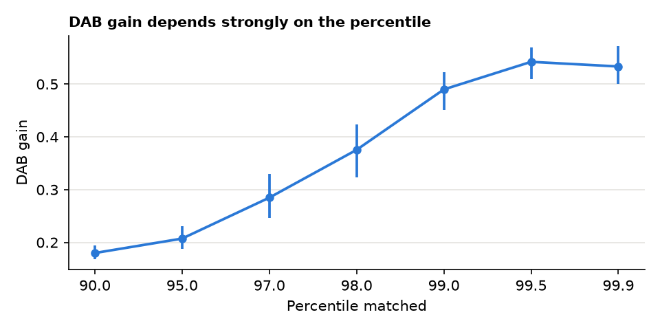
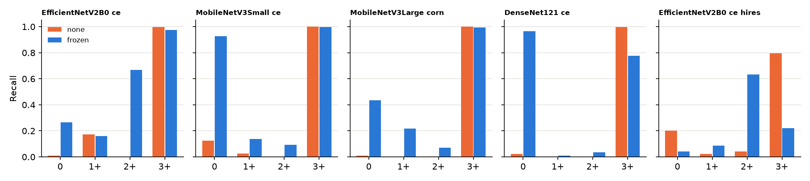
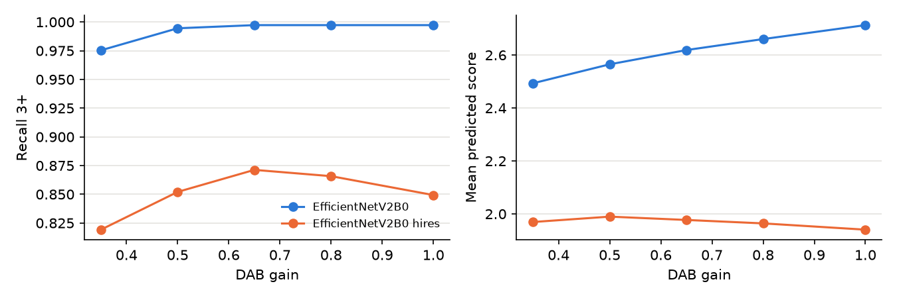
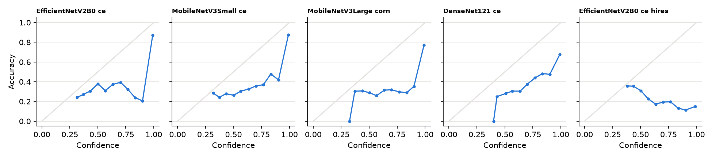

# HARMONISE-2 reliability results

Generated by `run_h2.py --stage report`. Development tiles only. The external test split was not read. Tiles share the 86 development slides with HARMONISE-1's fit and selection tiles, and index blocks are not slides.

## A. Calibration stability

Gains at p99, n = 1500: CV g_d 0.042, CV g_h 0.030. Smallest sample meeting the CV limit: 1000.

| n | g_h_mean | g_h_cv | g_d_mean | g_d_cv | g_d_lo | g_d_hi |
|---|---|---|---|---|---|---|
| 100.000 | 0.257 | 0.123 | 0.478 | 0.142 | 0.352 | 0.600 |
| 300.000 | 0.262 | 0.052 | 0.460 | 0.106 | 0.364 | 0.516 |
| 1000.000 | 0.266 | 0.033 | 0.482 | 0.055 | 0.436 | 0.529 |
| 1500.000 | 0.263 | 0.030 | 0.490 | 0.042 | 0.451 | 0.523 |

| run | balanced_accuracy_mean | balanced_accuracy_min | balanced_accuracy_max | qwk_mean | qwk_min | qwk_max | recall_0_range | recall_1+_range | recall_2+_range | recall_3+_range | balacc_range | params_stable | performance_stable |
|---|---|---|---|---|---|---|---|---|---|---|---|---|---|
| EfficientNetV2B0__ce | 0.504 | 0.502 | 0.507 | 0.490 | 0.480 | 0.496 | 0.037 | 0.049 | 0.048 | 0.017 | 0.005 | True | True |
| MobileNetV3Small__ce | 0.517 | 0.509 | 0.528 | 0.739 | 0.726 | 0.754 | 0.025 | 0.020 | 0.036 | 0.000 | 0.018 | True | True |

Grid edge and class composition:

| run | id | g_h | g_d | balanced_accuracy | qwk | recall_0 | recall_1+ | recall_2+ | recall_3+ |
|---|---|---|---|---|---|---|---|---|---|
| MobileNetV3Small__ce | edge_p97 | 0.263 | 0.281 | 0.426 | 0.575 | 0.768 | 0.062 | 0.006 | 0.866 |
| MobileNetV3Small__ce | edge_p98 | 0.263 | 0.374 | 0.490 | 0.696 | 0.874 | 0.066 | 0.030 | 0.990 |
| MobileNetV3Small__ce | edge_p99 | 0.263 | 0.488 | 0.516 | 0.737 | 0.905 | 0.115 | 0.042 | 1.000 |
| MobileNetV3Small__ce | edge_p99.5 | 0.263 | 0.540 | 0.514 | 0.733 | 0.893 | 0.121 | 0.042 | 1.000 |
| MobileNetV3Small__ce | share3plus_0.05 | 0.257 | 0.746 | 0.491 | 0.700 | 0.790 | 0.143 | 0.030 | 1.000 |
| MobileNetV3Small__ce | share3plus_0.15 | 0.258 | 0.557 | 0.516 | 0.737 | 0.892 | 0.130 | 0.042 | 1.000 |
| MobileNetV3Small__ce | share3plus_0.3 | 0.257 | 0.492 | 0.519 | 0.746 | 0.913 | 0.116 | 0.048 | 1.000 |
| MobileNetV3Small__ce | share3plus_0.5 | 0.267 | 0.452 | 0.506 | 0.721 | 0.900 | 0.082 | 0.042 | 1.000 |
| EfficientNetV2B0__ce | edge_p97 | 0.263 | 0.281 | 0.494 | 0.432 | 0.336 | 0.343 | 0.570 | 0.727 |
| EfficientNetV2B0__ce | edge_p98 | 0.263 | 0.374 | 0.500 | 0.478 | 0.318 | 0.264 | 0.521 | 0.898 |
| EfficientNetV2B0__ce | edge_p99 | 0.263 | 0.488 | 0.506 | 0.489 | 0.290 | 0.244 | 0.533 | 0.958 |
| EfficientNetV2B0__ce | edge_p99.5 | 0.263 | 0.540 | 0.498 | 0.490 | 0.264 | 0.230 | 0.533 | 0.966 |
| EfficientNetV2B0__ce | share3plus_0.05 | 0.257 | 0.746 | 0.414 | 0.438 | 0.147 | 0.169 | 0.376 | 0.966 |
| EfficientNetV2B0__ce | share3plus_0.15 | 0.258 | 0.557 | 0.485 | 0.489 | 0.251 | 0.205 | 0.515 | 0.967 |
| EfficientNetV2B0__ce | share3plus_0.3 | 0.257 | 0.492 | 0.504 | 0.495 | 0.292 | 0.220 | 0.545 | 0.958 |
| EfficientNetV2B0__ce | share3plus_0.5 | 0.267 | 0.452 | 0.509 | 0.478 | 0.297 | 0.261 | 0.533 | 0.945 |

## B. WSI-level generalisation

**Not possible as specified: no genuine slide identifiers exist.**

- archives hold PNG tiles only, no CSV or metadata
- filenames are her2-<score>-score_<split>_<number>.png, numbered per score
- the Zenodo record and the authors' repository give no patch-to-slide mapping
- the WSI/ and ROI/ folders named in the record are not in the local archives
- Only genuine boundary: 86 development WSIs vs 21 test WSIs, already used once by HARMONISE-1.

Index-block ICC (class removed): {'od_mean': 0.4334077052851558, 'blue_minus_red_od': 0.4486581423917611, 'od_p95': 0.6284709050735717}. Surrogate allowed: True.

## C. Class-wise reliability

| run | arm | accuracy | balanced_accuracy | macro_f1 | qwk | off_by_2plus | recall_0 | recall_1+ | recall_2+ | recall_3+ | precision_0 | precision_1+ | precision_2+ | precision_3+ |
|---|---|---|---|---|---|---|---|---|---|---|---|---|---|---|
| EfficientNetV2B0__ce | none | 0.367 | 0.295 | 0.204 | 0.082 | 0.524 | 0.010 | 0.173 | 0.000 | 0.999 | 0.548 | 0.519 | 0.000 | 0.368 |
| EfficientNetV2B0__ce | frozen | 0.497 | 0.517 | 0.429 | 0.525 | 0.265 | 0.265 | 0.161 | 0.668 | 0.974 | 0.793 | 0.398 | 0.107 | 0.848 |
| MobileNetV3Small__ce | none | 0.379 | 0.288 | 0.198 | 0.117 | 0.536 | 0.126 | 0.026 | 0.000 | 1.000 | 0.907 | 0.270 | 0.000 | 0.353 |
| MobileNetV3Small__ce | frozen | 0.717 | 0.539 | 0.507 | 0.799 | 0.130 | 0.928 | 0.139 | 0.093 | 0.997 | 0.770 | 0.637 | 0.248 | 0.698 |
| MobileNetV3Large__corn | none | 0.329 | 0.254 | 0.147 | 0.109 | 0.582 | 0.011 | 0.000 | 0.003 | 1.000 | 0.909 | 0.000 | 0.001 | 0.392 |
| MobileNetV3Large__corn | frozen | 0.543 | 0.429 | 0.404 | 0.409 | 0.343 | 0.436 | 0.217 | 0.070 | 0.993 | 0.795 | 0.532 | 0.067 | 0.512 |
| DenseNet121__ce | none | 0.332 | 0.255 | 0.136 | 0.025 | 0.592 | 0.022 | 0.000 | 0.000 | 0.997 | 0.826 | 0.000 | 0.000 | 0.334 |
| DenseNet121__ce | frozen | 0.627 | 0.447 | 0.404 | 0.758 | 0.140 | 0.964 | 0.010 | 0.037 | 0.777 | 0.598 | 0.040 | 0.076 | 0.853 |
| EfficientNetV2B0__ce__hires | none | 0.344 | 0.266 | 0.259 | 0.350 | 0.392 | 0.201 | 0.023 | 0.043 | 0.797 | 0.440 | 0.094 | 0.008 | 0.637 |
| EfficientNetV2B0__ce__hires | frozen | 0.149 | 0.246 | 0.153 | -0.027 | 0.480 | 0.042 | 0.087 | 0.635 | 0.222 | 0.851 | 0.149 | 0.058 | 0.559 |

Flags:

| run | cls | recall_none | recall_frozen | delta_recall | f1_frozen | deteriorated | class_failure | qwk_gain | hidden |
|---|---|---|---|---|---|---|---|---|---|
| EfficientNetV2B0__ce | 0 | 0.010 | 0.265 | 0.255 | 0.397 | False | False | 0.443 | False |
| EfficientNetV2B0__ce | 1+ | 0.173 | 0.161 | -0.013 | 0.229 | False | True | 0.443 | True |
| EfficientNetV2B0__ce | 2+ | 0.000 | 0.668 | 0.668 | 0.185 | False | True | 0.443 | False |
| EfficientNetV2B0__ce | 3+ | 0.999 | 0.974 | -0.025 | 0.907 | False | False | 0.443 | False |
| MobileNetV3Small__ce | 0 | 0.126 | 0.928 | 0.802 | 0.842 | False | False | 0.682 | False |
| MobileNetV3Small__ce | 1+ | 0.026 | 0.139 | 0.113 | 0.228 | False | True | 0.682 | True |
| MobileNetV3Small__ce | 2+ | 0.000 | 0.093 | 0.093 | 0.135 | False | True | 0.682 | True |
| MobileNetV3Small__ce | 3+ | 1.000 | 0.997 | -0.003 | 0.821 | False | False | 0.682 | False |
| MobileNetV3Large__corn | 0 | 0.011 | 0.436 | 0.425 | 0.563 | False | False | 0.300 | False |
| MobileNetV3Large__corn | 1+ | 0.000 | 0.217 | 0.217 | 0.308 | False | False | 0.300 | False |
| MobileNetV3Large__corn | 2+ | 0.003 | 0.070 | 0.066 | 0.068 | False | True | 0.300 | True |
| MobileNetV3Large__corn | 3+ | 1.000 | 0.993 | -0.007 | 0.676 | False | False | 0.300 | False |
| DenseNet121__ce | 0 | 0.022 | 0.964 | 0.942 | 0.738 | False | False | 0.732 | False |
| DenseNet121__ce | 1+ | 0.000 | 0.010 | 0.010 | 0.016 | False | True | 0.732 | True |
| DenseNet121__ce | 2+ | 0.000 | 0.037 | 0.037 | 0.049 | False | True | 0.732 | True |
| DenseNet121__ce | 3+ | 0.997 | 0.777 | -0.220 | 0.813 | True | False | 0.732 | True |
| EfficientNetV2B0__ce__hires | 0 | 0.201 | 0.042 | -0.159 | 0.080 | True | True | -0.377 | False |
| EfficientNetV2B0__ce__hires | 1+ | 0.023 | 0.087 | 0.064 | 0.110 | False | True | -0.377 | False |
| EfficientNetV2B0__ce__hires | 2+ | 0.043 | 0.635 | 0.591 | 0.106 | False | True | -0.377 | False |
| EfficientNetV2B0__ce__hires | 3+ | 0.797 | 0.222 | -0.576 | 0.317 | True | False | -0.377 | False |

## D. Resolution compatibility

| arm | g_h | g_d | balanced_accuracy | delta_vs_none | recall_3plus | delta_recall_3plus | meets_rule |
|---|---|---|---|---|---|---|---|
| frozen | 0.255 | 0.504 | 0.228 | -0.050 | 0.307 | -0.542 | False |
| rescompat | 0.255 | 0.492 | 0.227 | -0.052 | 0.304 | -0.545 | False |
| rescompat_dab_only | 1.000 | 0.492 | 0.267 | -0.011 | 0.852 | 0.003 | False |
| frozen_scale2 | 0.255 | 0.504 | 0.322 | 0.043 | 0.701 | -0.148 | False |
| rescompat_scale2 | 0.255 | 0.492 | 0.320 | 0.042 | 0.701 | -0.148 | False |

## E. Prediction confidence

| run | arm | T | ece | nll | accuracy | mean_confidence |
|---|---|---|---|---|---|---|
| EfficientNetV2B0__ce | bci_val_reference | 1.000 | 0.061 | 0.350 | 0.895 | 0.950 |
| EfficientNetV2B0__ce | none | 1.000 | 0.555 | 3.992 | 0.344 | 0.899 |
| EfficientNetV2B0__ce | none_temp_scaled | 7.839 | 0.236 | 1.300 | 0.344 | 0.467 |
| EfficientNetV2B0__ce | frozen | 1.000 | 0.258 | 1.509 | 0.484 | 0.741 |
| EfficientNetV2B0__ce | frozen_temp_scaled | 2.842 | 0.100 | 1.102 | 0.484 | 0.540 |
| MobileNetV3Small__ce | bci_val_reference | 1.000 | 0.054 | 0.418 | 0.854 | 0.900 |
| MobileNetV3Small__ce | none | 1.000 | 0.613 | 5.812 | 0.341 | 0.953 |
| MobileNetV3Small__ce | none_temp_scaled | 9.163 | 0.246 | 1.295 | 0.341 | 0.535 |
| MobileNetV3Small__ce | frozen | 1.000 | 0.196 | 1.159 | 0.677 | 0.874 |
| MobileNetV3Small__ce | frozen_temp_scaled | 2.080 | 0.079 | 0.810 | 0.677 | 0.756 |
| MobileNetV3Large__corn | bci_val_reference | 1.000 | 0.062 | 0.355 | 0.894 | 0.950 |
| MobileNetV3Large__corn | none | 1.000 | 0.647 | 8.037 | 0.299 | 0.946 |
| MobileNetV3Large__corn | none_temp_scaled | 18.498 | 0.259 | 1.399 | 0.299 | 0.384 |
| MobileNetV3Large__corn | frozen | 1.000 | 0.326 | 1.998 | 0.495 | 0.821 |
| MobileNetV3Large__corn | frozen_temp_scaled | 3.322 | 0.119 | 1.105 | 0.495 | 0.605 |
| DenseNet121__ce | bci_val_reference | 1.000 | 0.033 | 0.282 | 0.908 | 0.924 |
| DenseNet121__ce | none | 1.000 | 0.663 | 10.257 | 0.297 | 0.960 |
| DenseNet121__ce | none_temp_scaled | 20.000 | 0.154 | 1.428 | 0.297 | 0.404 |
| DenseNet121__ce | frozen | 1.000 | 0.323 | 2.833 | 0.602 | 0.925 |
| DenseNet121__ce | frozen_temp_scaled | 5.306 | 0.061 | 1.062 | 0.602 | 0.598 |
| EfficientNetV2B0__ce__hires | bci_val_reference | 1.000 | 0.029 | 0.167 | 0.950 | 0.975 |
| EfficientNetV2B0__ce__hires | none | 1.000 | 0.519 | 4.081 | 0.347 | 0.865 |
| EfficientNetV2B0__ce__hires | none_temp_scaled | 13.538 | 0.134 | 1.327 | 0.347 | 0.363 |
| EfficientNetV2B0__ce__hires | frozen | 1.000 | 0.710 | 4.675 | 0.165 | 0.875 |
| EfficientNetV2B0__ce__hires | frozen_temp_scaled | 20.000 | 0.206 | 1.375 | 0.165 | 0.319 |

| run | target_coverage | coverage | accuracy_all | accuracy_kept | accuracy_gain | error_auroc | share_2plus_referred | usable |
|---|---|---|---|---|---|---|---|---|
| EfficientNetV2B0__ce | 0.500 | 0.451 | 0.484 | 0.662 | 0.179 | 0.743 | 0.758 | False |
| EfficientNetV2B0__ce | 0.700 | 0.674 | 0.484 | 0.561 | 0.078 | 0.743 | 0.442 | False |
| EfficientNetV2B0__ce | 0.900 | 0.887 | 0.484 | 0.510 | 0.027 | 0.743 | 0.139 | False |
| MobileNetV3Small__ce | 0.500 | 0.460 | 0.677 | 0.930 | 0.253 | 0.844 | 0.939 | False |
| MobileNetV3Small__ce | 0.700 | 0.655 | 0.677 | 0.852 | 0.175 | 0.844 | 0.673 | False |
| MobileNetV3Small__ce | 0.900 | 0.872 | 0.677 | 0.735 | 0.058 | 0.844 | 0.248 | False |
| MobileNetV3Large__corn | 0.500 | 0.509 | 0.495 | 0.688 | 0.192 | 0.778 | 0.448 | False |
| MobileNetV3Large__corn | 0.700 | 0.747 | 0.495 | 0.564 | 0.069 | 0.778 | 0.158 | False |
| MobileNetV3Large__corn | 0.900 | 0.930 | 0.495 | 0.510 | 0.015 | 0.778 | 0.030 | False |
| DenseNet121__ce | 0.500 | 0.454 | 0.602 | 0.709 | 0.107 | 0.652 | 0.418 | False |
| DenseNet121__ce | 0.700 | 0.681 | 0.602 | 0.680 | 0.078 | 0.652 | 0.315 | False |
| DenseNet121__ce | 0.900 | 0.899 | 0.602 | 0.635 | 0.033 | 0.652 | 0.097 | False |
| EfficientNetV2B0__ce__hires | 0.500 | 0.598 | 0.165 | 0.148 | -0.017 | 0.517 | 0.594 | False |
| EfficientNetV2B0__ce__hires | 0.700 | 0.753 | 0.165 | 0.143 | -0.022 | 0.517 | 0.358 | False |
| EfficientNetV2B0__ce__hires | 0.900 | 0.905 | 0.165 | 0.153 | -0.012 | 0.517 | 0.115 | False |

