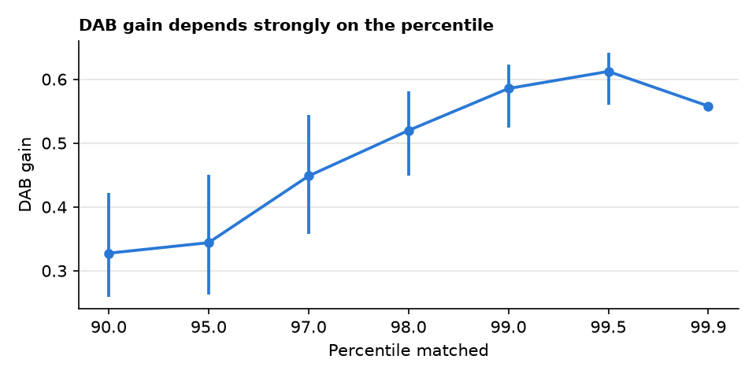
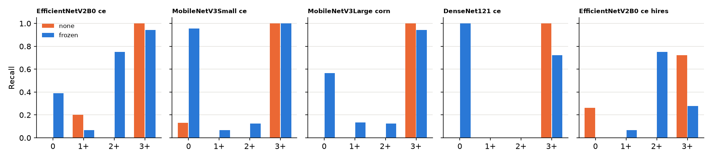
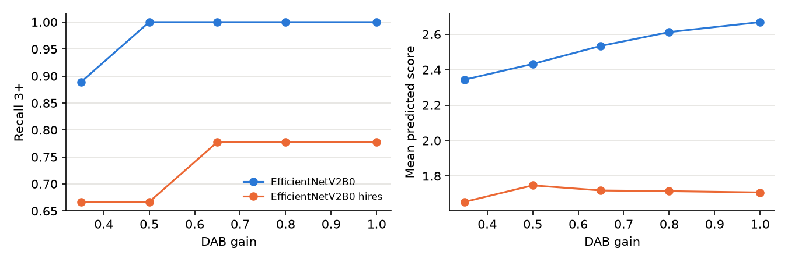
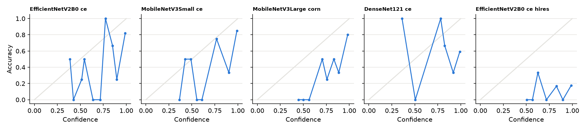

# HARMONISE-2 reliability results

Generated by `run_h2.py --stage report`. Development tiles only. The external test split was not read. Tiles share the 86 development slides with HARMONISE-1's fit and selection tiles, and index blocks are not slides.

## A. Calibration stability

Gains at p99, n = 40: CV g_d 0.097, CV g_h 0.296. Smallest sample meeting the CV limit: None.

| n | g_h_mean | g_h_cv | g_d_mean | g_d_cv | g_d_lo | g_d_hi |
|---|---|---|---|---|---|---|
| 20.000 | 0.207 | 0.191 | 0.574 | 0.212 | 0.465 | 0.696 |
| 40.000 | 0.260 | 0.296 | 0.585 | 0.097 | 0.525 | 0.623 |

| run | balanced_accuracy_mean | balanced_accuracy_min | balanced_accuracy_max | qwk_mean | qwk_min | qwk_max | recall_0_range | recall_1+_range | recall_2+_range | recall_3+_range | balacc_range | params_stable | performance_stable |
|---|---|---|---|---|---|---|---|---|---|---|---|---|---|
| EfficientNetV2B0__ce | 0.559 | 0.498 | 0.620 | 0.584 | 0.531 | 0.637 | 0.154 | 0.333 | 0.000 | 0.000 | 0.122 | False | False |
| MobileNetV3Small__ce | 0.470 | 0.423 | 0.517 | 0.667 | 0.571 | 0.764 | 0.154 | 0.222 | 0.000 | 0.000 | 0.094 | False | False |

Grid edge and class composition:

| run | id | g_h | g_d | balanced_accuracy | qwk | recall_0 | recall_1+ | recall_2+ | recall_3+ |
|---|---|---|---|---|---|---|---|---|---|
| MobileNetV3Small__ce | edge_p97 | 0.246 | 0.368 | 0.481 | 0.738 | 0.923 | 0.000 | 0.000 | 1.000 |
| MobileNetV3Small__ce | edge_p98 | 0.246 | 0.465 | 0.528 | 0.789 | 1.000 | 0.111 | 0.000 | 1.000 |
| MobileNetV3Small__ce | edge_p99 | 0.246 | 0.551 | 0.564 | 0.765 | 0.923 | 0.333 | 0.000 | 1.000 |
| MobileNetV3Small__ce | edge_p99.5 | 0.246 | 0.589 | 0.545 | 0.759 | 0.846 | 0.333 | 0.000 | 1.000 |
| MobileNetV3Small__ce | share3plus_0.05 | 0.219 | 0.812 | 0.423 | 0.626 | 0.692 | 0.000 | 0.000 | 1.000 |
| MobileNetV3Small__ce | share3plus_0.15 | 0.234 | 0.637 | 0.498 | 0.723 | 0.769 | 0.222 | 0.000 | 1.000 |
| MobileNetV3Small__ce | share3plus_0.3 | 0.249 | 0.573 | 0.564 | 0.770 | 0.923 | 0.333 | 0.000 | 1.000 |
| MobileNetV3Small__ce | share3plus_0.5 | 0.262 | 0.501 | 0.509 | 0.756 | 0.923 | 0.111 | 0.000 | 1.000 |
| EfficientNetV2B0__ce | edge_p97 | 0.246 | 0.368 | 0.608 | 0.671 | 0.462 | 0.222 | 0.750 | 1.000 |
| EfficientNetV2B0__ce | edge_p98 | 0.246 | 0.465 | 0.575 | 0.725 | 0.538 | 0.111 | 0.750 | 0.900 |
| EfficientNetV2B0__ce | edge_p99 | 0.246 | 0.551 | 0.498 | 0.518 | 0.231 | 0.111 | 0.750 | 0.900 |
| EfficientNetV2B0__ce | edge_p99.5 | 0.246 | 0.589 | 0.498 | 0.531 | 0.231 | 0.111 | 0.750 | 0.900 |
| EfficientNetV2B0__ce | share3plus_0.05 | 0.219 | 0.812 | 0.398 | 0.548 | 0.231 | 0.111 | 0.250 | 1.000 |
| EfficientNetV2B0__ce | share3plus_0.15 | 0.234 | 0.637 | 0.435 | 0.532 | 0.231 | 0.111 | 0.500 | 0.900 |
| EfficientNetV2B0__ce | share3plus_0.3 | 0.249 | 0.573 | 0.498 | 0.531 | 0.231 | 0.111 | 0.750 | 0.900 |
| EfficientNetV2B0__ce | share3plus_0.5 | 0.262 | 0.501 | 0.564 | 0.578 | 0.385 | 0.222 | 0.750 | 0.900 |

## B. WSI-level generalisation

**Not possible as specified: no genuine slide identifiers exist.**

- archives hold PNG tiles only, no CSV or metadata
- filenames are her2-<score>-score_<split>_<number>.png, numbered per score
- the Zenodo record and the authors' repository give no patch-to-slide mapping
- the WSI/ and ROI/ folders named in the record are not in the local archives
- Only genuine boundary: 86 development WSIs vs 21 test WSIs, already used once by HARMONISE-1.

Index-block ICC (class removed): {'od_mean': -0.2680482883126315, 'blue_minus_red_od': -0.3300545518687528, 'od_p95': -0.18627836105940326}. Surrogate allowed: False.

## C. Class-wise reliability

| run | arm | accuracy | balanced_accuracy | macro_f1 | qwk | off_by_2plus | recall_0 | recall_1+ | recall_2+ | recall_3+ | precision_0 | precision_1+ | precision_2+ | precision_3+ |
|---|---|---|---|---|---|---|---|---|---|---|---|---|---|---|
| EfficientNetV2B0__ce | none | 0.328 | 0.300 | 0.190 | 0.077 | 0.500 | 0.000 | 0.200 | 0.000 | 1.000 | 0.000 | 0.500 | 0.000 | 0.310 |
| EfficientNetV2B0__ce | frozen | 0.516 | 0.538 | 0.463 | 0.568 | 0.203 | 0.391 | 0.067 | 0.750 | 0.944 | 0.818 | 0.333 | 0.200 | 0.850 |
| MobileNetV3Small__ce | none | 0.328 | 0.283 | 0.176 | 0.151 | 0.500 | 0.130 | 0.000 | 0.000 | 1.000 | 1.000 | 0.000 | 0.000 | 0.310 |
| MobileNetV3Small__ce | frozen | 0.656 | 0.537 | 0.479 | 0.783 | 0.141 | 0.957 | 0.067 | 0.125 | 1.000 | 0.667 | 0.333 | 0.333 | 0.720 |
| MobileNetV3Large__corn | none | 0.281 | 0.250 | 0.120 | 0.082 | 0.578 | 0.000 | 0.000 | 0.000 | 1.000 | 0.000 | 0.000 | 0.000 | 0.316 |
| MobileNetV3Large__corn | frozen | 0.516 | 0.442 | 0.406 | 0.486 | 0.281 | 0.565 | 0.133 | 0.125 | 0.944 | 0.722 | 0.286 | 0.167 | 0.515 |
| DenseNet121__ce | none | 0.281 | 0.250 | 0.110 | 0.000 | 0.594 | 0.000 | 0.000 | 0.000 | 1.000 | 0.000 | 0.000 | 0.000 | 0.281 |
| DenseNet121__ce | frozen | 0.562 | 0.431 | 0.377 | 0.713 | 0.172 | 1.000 | 0.000 | 0.000 | 0.722 | 0.535 | 0.000 | 0.000 | 0.929 |
| EfficientNetV2B0__ce__hires | none | 0.297 | 0.246 | 0.234 | 0.247 | 0.391 | 0.261 | 0.000 | 0.000 | 0.722 | 0.400 | 0.000 | 0.000 | 0.542 |
| EfficientNetV2B0__ce__hires | frozen | 0.188 | 0.274 | 0.176 | -0.132 | 0.484 | 0.000 | 0.067 | 0.750 | 0.278 | 0.000 | 0.077 | 0.136 | 0.714 |

Flags:

| run | cls | recall_none | recall_frozen | delta_recall | f1_frozen | deteriorated | class_failure | qwk_gain | hidden |
|---|---|---|---|---|---|---|---|---|---|
| EfficientNetV2B0__ce | 0 | 0.000 | 0.391 | 0.391 | 0.529 | False | False | 0.491 | False |
| EfficientNetV2B0__ce | 1+ | 0.200 | 0.067 | -0.133 | 0.111 | True | True | 0.491 | True |
| EfficientNetV2B0__ce | 2+ | 0.000 | 0.750 | 0.750 | 0.316 | False | False | 0.491 | False |
| EfficientNetV2B0__ce | 3+ | 1.000 | 0.944 | -0.056 | 0.895 | True | False | 0.491 | True |
| MobileNetV3Small__ce | 0 | 0.130 | 0.957 | 0.826 | 0.786 | False | False | 0.632 | False |
| MobileNetV3Small__ce | 1+ | 0.000 | 0.067 | 0.067 | 0.111 | False | True | 0.632 | True |
| MobileNetV3Small__ce | 2+ | 0.000 | 0.125 | 0.125 | 0.182 | False | True | 0.632 | True |
| MobileNetV3Small__ce | 3+ | 1.000 | 1.000 | 0.000 | 0.837 | False | False | 0.632 | False |
| MobileNetV3Large__corn | 0 | 0.000 | 0.565 | 0.565 | 0.634 | False | False | 0.403 | False |
| MobileNetV3Large__corn | 1+ | 0.000 | 0.133 | 0.133 | 0.182 | False | True | 0.403 | True |
| MobileNetV3Large__corn | 2+ | 0.000 | 0.125 | 0.125 | 0.143 | False | True | 0.403 | True |
| MobileNetV3Large__corn | 3+ | 1.000 | 0.944 | -0.056 | 0.667 | True | False | 0.403 | True |
| DenseNet121__ce | 0 | 0.000 | 1.000 | 1.000 | 0.697 | False | False | 0.713 | False |
| DenseNet121__ce | 1+ | 0.000 | 0.000 | 0.000 | 0.000 | False | True | 0.713 | True |
| DenseNet121__ce | 2+ | 0.000 | 0.000 | 0.000 | 0.000 | False | True | 0.713 | True |
| DenseNet121__ce | 3+ | 1.000 | 0.722 | -0.278 | 0.813 | True | False | 0.713 | True |
| EfficientNetV2B0__ce__hires | 0 | 0.261 | 0.000 | -0.261 | 0.000 | True | True | -0.379 | False |
| EfficientNetV2B0__ce__hires | 1+ | 0.000 | 0.067 | 0.067 | 0.071 | False | True | -0.379 | False |
| EfficientNetV2B0__ce__hires | 2+ | 0.000 | 0.750 | 0.750 | 0.231 | False | False | -0.379 | False |
| EfficientNetV2B0__ce__hires | 3+ | 0.722 | 0.278 | -0.444 | 0.400 | True | False | -0.379 | False |

## D. Resolution compatibility

| arm | g_h | g_d | balanced_accuracy | delta_vs_none | recall_3plus | delta_recall_3plus | meets_rule |
|---|---|---|---|---|---|---|---|
| frozen | 0.255 | 0.504 | 0.208 | -0.086 | 0.333 | -0.444 | False |
| rescompat | 0.245 | 0.541 | 0.236 | -0.058 | 0.333 | -0.444 | False |
| rescompat_dab_only | 1.000 | 0.541 | 0.244 | -0.050 | 0.667 | -0.111 | False |
| frozen_scale2 | 0.255 | 0.504 | 0.201 | -0.093 | 0.222 | -0.556 | False |
| rescompat_scale2 | 0.245 | 0.541 | 0.201 | -0.093 | 0.222 | -0.556 | False |

## E. Prediction confidence

| run | arm | T | ece | nll | accuracy | mean_confidence |
|---|---|---|---|---|---|---|
| EfficientNetV2B0__ce | bci_val_reference | 1.000 | 0.061 | 0.350 | 0.895 | 0.950 |
| EfficientNetV2B0__ce | none | 1.000 | 0.589 | 3.930 | 0.333 | 0.897 |
| EfficientNetV2B0__ce | none_temp_scaled | 12.521 | 0.257 | 1.304 | 0.333 | 0.379 |
| EfficientNetV2B0__ce | frozen | 1.000 | 0.320 | 1.545 | 0.472 | 0.755 |
| EfficientNetV2B0__ce | frozen_temp_scaled | 1.645 | 0.207 | 1.216 | 0.472 | 0.660 |
| MobileNetV3Small__ce | bci_val_reference | 1.000 | 0.054 | 0.418 | 0.854 | 0.900 |
| MobileNetV3Small__ce | none | 1.000 | 0.605 | 4.985 | 0.333 | 0.924 |
| MobileNetV3Small__ce | none_temp_scaled | 10.711 | 0.234 | 1.261 | 0.333 | 0.464 |
| MobileNetV3Small__ce | frozen | 1.000 | 0.205 | 1.101 | 0.639 | 0.835 |
| MobileNetV3Small__ce | frozen_temp_scaled | 2.628 | 0.229 | 0.813 | 0.639 | 0.663 |
| MobileNetV3Large__corn | bci_val_reference | 1.000 | 0.062 | 0.355 | 0.894 | 0.950 |
| MobileNetV3Large__corn | none | 1.000 | 0.642 | 7.458 | 0.278 | 0.920 |
| MobileNetV3Large__corn | none_temp_scaled | 20.000 | 0.148 | 1.409 | 0.278 | 0.357 |
| MobileNetV3Large__corn | frozen | 1.000 | 0.355 | 2.077 | 0.472 | 0.827 |
| MobileNetV3Large__corn | frozen_temp_scaled | 4.908 | 0.189 | 1.111 | 0.472 | 0.511 |
| DenseNet121__ce | bci_val_reference | 1.000 | 0.033 | 0.282 | 0.908 | 0.924 |
| DenseNet121__ce | none | 1.000 | 0.713 | 9.021 | 0.278 | 0.991 |
| DenseNet121__ce | none_temp_scaled | 20.000 | 0.231 | 1.394 | 0.278 | 0.393 |
| DenseNet121__ce | frozen | 1.000 | 0.398 | 3.294 | 0.583 | 0.933 |
| DenseNet121__ce | frozen_temp_scaled | 7.250 | 0.230 | 1.160 | 0.583 | 0.499 |
| EfficientNetV2B0__ce__hires | bci_val_reference | 1.000 | 0.029 | 0.167 | 0.950 | 0.975 |
| EfficientNetV2B0__ce__hires | none | 1.000 | 0.482 | 3.619 | 0.333 | 0.815 |
| EfficientNetV2B0__ce__hires | none_temp_scaled | 20.000 | 0.074 | 1.356 | 0.333 | 0.308 |
| EfficientNetV2B0__ce__hires | frozen | 1.000 | 0.714 | 4.425 | 0.139 | 0.853 |
| EfficientNetV2B0__ce__hires | frozen_temp_scaled | 20.000 | 0.237 | 1.380 | 0.139 | 0.313 |

| run | target_coverage | coverage | accuracy_all | accuracy_kept | accuracy_gain | error_auroc | share_2plus_referred | usable |
|---|---|---|---|---|---|---|---|---|
| EfficientNetV2B0__ce | 0.500 | 0.500 | 0.472 | 0.667 | 0.194 | 0.789 | 0.000 | False |
| EfficientNetV2B0__ce | 0.700 | 0.667 | 0.472 | 0.583 | 0.111 | 0.789 | 0.000 | False |
| EfficientNetV2B0__ce | 0.900 | 0.861 | 0.472 | 0.516 | 0.044 | 0.789 | 0.000 | False |
| MobileNetV3Small__ce | 0.500 | 0.278 | 0.639 | 1.000 | 0.361 | 0.860 | 1.000 | False |
| MobileNetV3Small__ce | 0.700 | 0.528 | 0.639 | 0.895 | 0.256 | 0.860 | 0.750 | False |
| MobileNetV3Small__ce | 0.900 | 0.750 | 0.639 | 0.778 | 0.139 | 0.860 | 0.250 | True |
| MobileNetV3Large__corn | 0.500 | 0.417 | 0.472 | 0.800 | 0.328 | 0.861 | 0.500 | False |
| MobileNetV3Large__corn | 0.700 | 0.583 | 0.472 | 0.667 | 0.194 | 0.861 | 0.250 | False |
| MobileNetV3Large__corn | 0.900 | 0.889 | 0.472 | 0.531 | 0.059 | 0.861 | 0.000 | False |
| DenseNet121__ce | 0.500 | 0.556 | 0.583 | 0.600 | 0.017 | 0.505 | 0.250 | False |
| DenseNet121__ce | 0.700 | 0.667 | 0.583 | 0.583 | 0.000 | 0.505 | 0.000 | False |
| DenseNet121__ce | 0.900 | 0.889 | 0.583 | 0.594 | 0.010 | 0.505 | 0.000 | False |
| EfficientNetV2B0__ce__hires | 0.500 | 0.472 | 0.139 | 0.176 | 0.038 | 0.665 | 0.500 | False |
| EfficientNetV2B0__ce__hires | 0.700 | 0.583 | 0.139 | 0.143 | 0.004 | 0.665 | 0.500 | False |
| EfficientNetV2B0__ce__hires | 0.900 | 0.861 | 0.139 | 0.161 | 0.022 | 0.665 | 0.000 | False |

