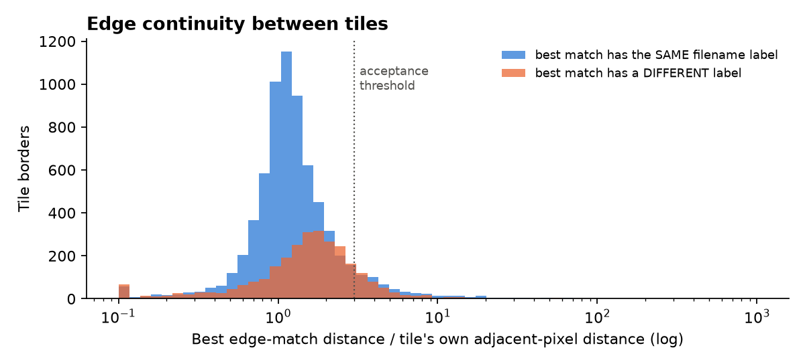
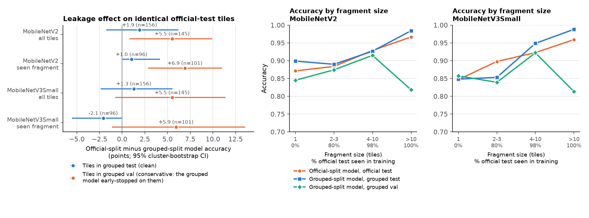
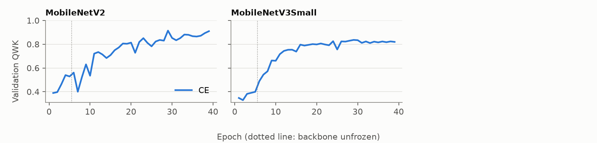
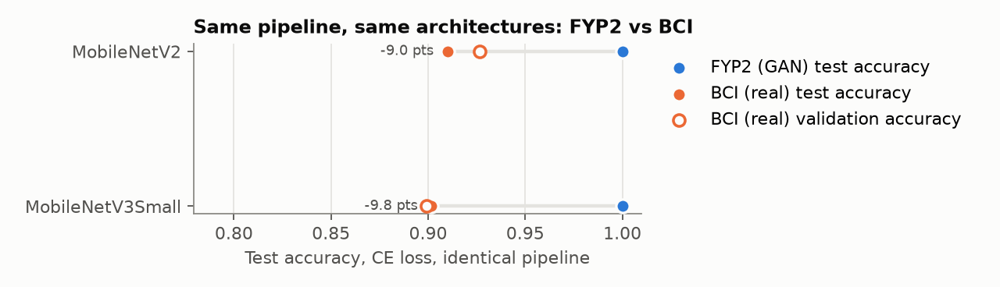
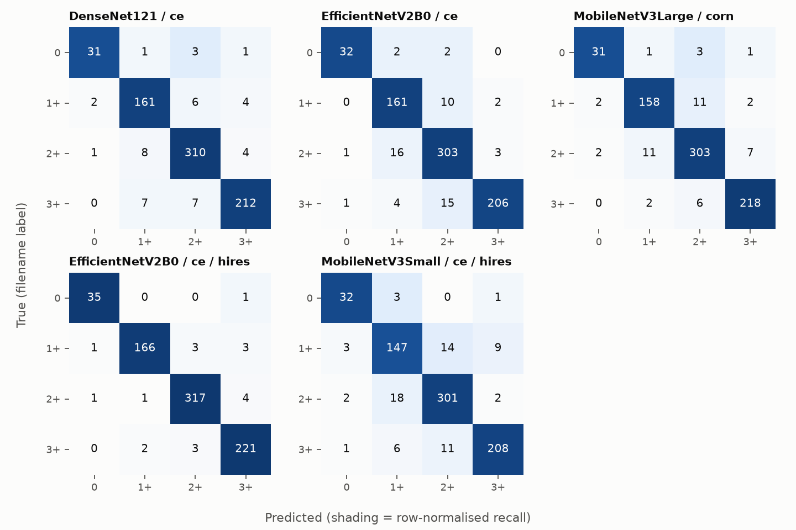
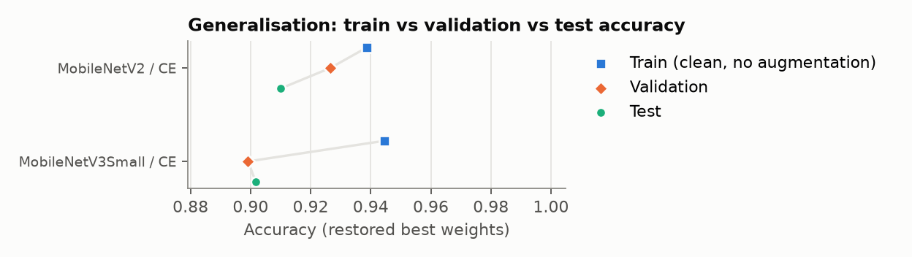
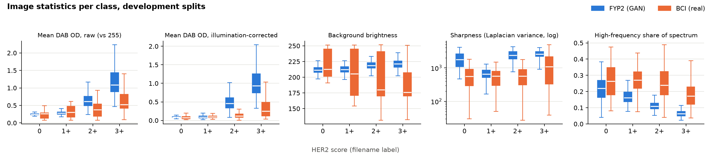
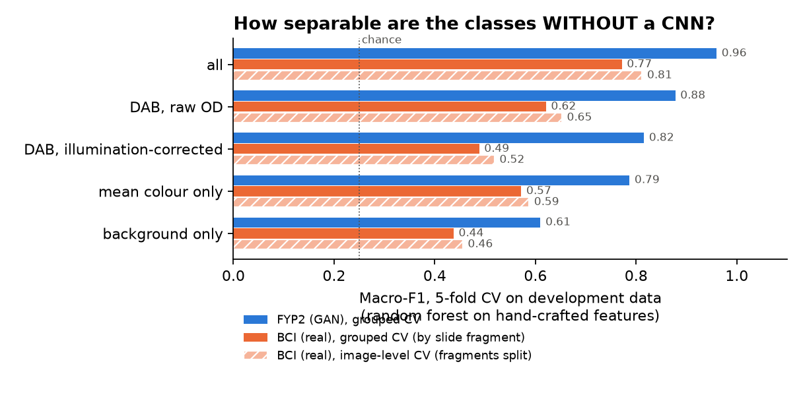
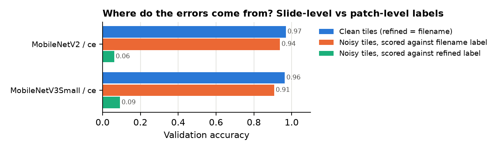

# FYP3: the FYP2 pipeline reproduced on real HER2 IHC (BCI)

> **Stale (note added 10 Nov 2026).** This report predates the E1–E5 runs, HARMONISE and `experiments_v2`; it covers 16 of the 20 grouped runs. Use `FYP3_FINAL_REPORT.md` and `experiments_v2/README.md` for current results (`experiments_v2/REPORT_CORRECTIONS_v2.md`, item 25).


A separate experiment. FYP2 remains the main project and was not modified; its results and weights were only read.

## 0. Findings (final, 30 Oct 2026)

**Status.** All runs are finished and evaluated (grouped split):
- 9 CE baselines;
- CORN for the 3 tier winners;
- 3 improvement variants on MobileNetV3Small, plus a confirmation run on EfficientNetV2B0;
- the full network analysis and a haematoxylin-cue test;
- 2 reference runs on the official split.

Each statement is marked **confirmed** (measured, with the evidence section named) or **hypothesis** (consistent
with the data, not tested). Decisions used validation only, and every comparison between two runs is a paired
difference on the same tiles with a 95% fragment-cluster bootstrap CI.

### Performance gap

- **Confirmed.** The FYP2 pipeline, unchanged, reaches 0.99–1.00 test accuracy on FYP2's GAN images. On BCI's real IHC
  tiles it reaches 0.91–0.95 test and 0.85–0.91 validation accuracy (sections 3–4).
  - Validation QWK is 0.76–0.87 on BCI, against 0.997–1.000 on FYP2.
- **Confirmed.** No tier winner is separable from its runner-up on validation (section 3). Δ val QWK [95% CI]:
  - DenseNet121 vs ConvNeXtTiny: +0.011 [−0.026, +0.043];
  - EfficientNetV2B0 vs EfficientNetB0: +0.024 [−0.017, +0.059];
  - MobileNetV3Large vs MobileNetV2: +0.016 [−0.079, +0.100].

  The tier ranking on BCI is therefore not reliable.

### Why BCI is harder: the data (no trained CNN involved)

1. **Confirmed: BCI's classes are far less separable before any task training** (section 6f).
   - A linear probe on frozen ImageNet EfficientNetB0 features reaches 0.978 accuracy / QWK 0.991 on FYP2, against
     0.765 / 0.698 on BCI.
   - Class separation (silhouette) is 0.168 vs 0.006.

   Most of the gap is a property of the images, not of the training pipeline.
2. **Confirmed: real stain separates the classes far less than the GAN images do** (section 6a).
   - Median tile DAB against each tile's own background, for 0 / 1+ / 2+ / 3+:
     - BCI: 0.08 / 0.10 / 0.12 / 0.25;
     - FYP2: 0.09 / 0.09 / 0.46 / 0.94.
   - A random forest on stain alone reaches macro-F1 0.49 on BCI, against 0.82 on FYP2.
3. **Confirmed: BCI labels describe the slide, not the tile** (section 6b).
   - The patch-level reference labels disagree with the slide label on 16–18% of held-out tiles.
   - On tiles where the two agree, the CE baselines reach 0.94–0.98 accuracy on validation and 0.97–1.00 on test.
4. **Confirmed: the FYP2 pipeline throws away resolution that BCI needs** (section 7).
   - FYP2's images are natively 256 px, so its 256 → 224 px pipeline loses nothing there. BCI's tiles are 1024 px, so the
     same pipeline keeps 1 pixel in 16.
   - Doubling the resolution (512 px source, 448 px input) is the one improvement that passed its pre-set rule, and it
     was confirmed on a second architecture (finding 9).
5. **Confirmed: scan type is associated with the label** (section 6c). Grey-background scans make up 25% / 44% / 52% / 68%
   of class 0 / 1+ / 2+ / 3+ tiles. As a shortcut it is minor (finding 7).
6. **Confirmed (measurement): the standard stain measure is distorted on BCI.** Optical density against 255 counts the
   grey glass as stain. Every stain statement here uses the background-corrected measure.

### What the networks learned (sections 6e–6h)

7. **Confirmed: the BCI networks read the brown stain, and scan brightness matters little.**
   - Grad-CAM attention is concentrated on DAB-rich pixels (ratio 1.05–1.15 on BCI, 1.13–1.40 on FYP2) and away from
     glass (background ratio < 1).
   - Scaling DAB moves the expected score in the right direction for every network.
   - Within a class, the error (expected score − slide label) rises with the tile's own DAB in all 16 BCI runs. The
     coefficients are +0.04 to +0.14 per SD, and every CI excludes 0. Many "errors" are therefore tiles whose own
     stain disagrees with their slide's label.
   - A 15% change in scan brightness shifts the expected score by at most 0.075 (median 0.056), below the pre-set
     0.10 rule. The observational brightness coefficient is small (−0.003 to −0.089 per SD).
8. **Confirmed: neither dataset's networks transfer to the other.**
   - Balanced accuracy (chance 0.25) is 0.30–0.46 for FYP2 → BCI and 0.28–0.51 for BCI → FYP2.
   - 8 of 9 FYP2-trained networks label 71–81% of BCI tiles "1+"; only 23% are.
   - On BCI test images, CKA (representation similarity) between the FYP2-trained and BCI-trained networks falls to
     0.65–0.85 at the last layer (0.45–0.86 on FYP2 images).

   The two training sets teach different decision rules on top of similar early features.
   - **Not confirmed: "FYP2 networks read low haematoxylin as 1+"** (section 6h). Bringing haematoxylin to the other
     group's level moved the median network's 1+ share by +16 points (×0.2). The pre-set rule needed ≥ 20 in both
     directions. Adding haematoxylin to BCI tiles removed most 1+ answers but did not raise balanced accuracy (−0.04).
   - **Hypothesis (untested):** FYP2 networks fail on BCI mainly because their DAB thresholds are calibrated to the
     GAN's exaggerated stain. BCI's 2+/3+ tiles carry about as much DAB as the GAN's 0/1+ images (finding 2).

### Improvements (section 7)

9. **Confirmed: higher input resolution helps.**

   | Model | Δ val QWK [95% CI] | Δ test QWK [95% CI] |
   |---|---|---|
   | MobileNetV3Small (screen) | +0.102 [+0.031, +0.173] | −0.014 [−0.063, +0.038] |
   | EfficientNetV2B0 (pre-registered confirmation) | **+0.065 [+0.026, +0.108]** | +0.044 [+0.009, +0.089] |

   - EfficientNetV2B0 at 448 px reaches 0.950 val / 0.975 test accuracy and 0.935 / 0.959 QWK. This is the best BCI
     result; the 224 px baseline reaches 0.895 / 0.926 accuracy.
   - Caveat: the batch size dropped from 32 to 8 with the resolution (memory), so the two are not separated.
   - Training cost rises about 5× (252 vs 49 min).
10. **Confirmed: class weights and label smoothing do not help.**
    - Class weights: Δ val QWK +0.023 [−0.040, +0.088].
    - Label smoothing: +0.004 [−0.045, +0.054]. It also lowers validation recall for score 0 (−0.11, CI excludes 0).
11. **Confirmed: CORN is not better than CE on BCI.**
    - Δ val QWK: DenseNet121 −0.013 [−0.064, +0.032]; EfficientNetV2B0 −0.039 [−0.095, +0.012]; MobileNetV3Large
      +0.025 [−0.004, +0.056].
    - The selection rule still picks MobileNetV3Large-CORN for the lite tier (higher point estimate); that choice is within noise.
12. **Not run, by pre-set rule:** the illumination and HED-stain augmentations. Their perturbation gates were not met
    (0.056 and 0.010 against 0.10; section 6g).

### Overfitting and evaluation design

13. **Confirmed: on BCI the FYP2 recipe overfits by FYP2's own rule; on FYP2 it does not** (section 5b).
    - Train − test accuracy is 2.2–6.6 points on BCI, against ≤ 0.7 on FYP2.
    - The log-loss gap is 0.05–0.20, against ≤ 0.02.
    - Noise-aware verdict: 8 of 16 runs "overfit", 7 "mild", 1 "none".
    - Early stopping on validation QWK worked: validation is *below* test for every run, so model selection did not overfit validation.
    - With 16–18% of tiles carrying a slide label their own appearance contradicts, a network that fits its training
      tiles well cannot transfer that fit.
    - The 2× resolution runs have the smallest gaps: train − test 2.2–2.5 points, log-loss gap 0.05–0.09.
14. **Confirmed: BCI's official split leaks across slides; the effect on accuracy is a few points** (section 1b).
    - 63% of official test tiles share a slide fragment with official training tiles.
    - On identical tiles, the leaky model is better by +1.3 to +1.9 points on easy tiles (CIs include 0) and +5.5 on harder ones.
15. **Confirmed: one held-out split is imprecise** (section 5c).
    - Test accuracy is 2.4–7.3 points above validation for every one of the 9 baselines.
    - A third of validation errors come from three large slide fragments.
    - Hence the paired, fragment-clustered comparisons throughout.

### Answer to the brief, in one paragraph

The FYP2 pipeline drops from about 100% (GAN images) to 91–95% test accuracy on real BCI IHC tiles. The drop is
explained mainly by the data:
- the classes are barely separable in generic features (frozen-probe accuracy 0.77 vs 0.98);
- real DAB separates 0/1+/2+ weakly;
- 16–18% of tiles carry a slide-level label their own stain contradicts.

The networks trained on each dataset read stain in the right direction, but they learn different decision rules and do
not transfer. One pipeline choice that is harmless on FYP2 does hurt BCI: downsampling its 1024 px tiles to 256 px.
Doubling the resolution was the only justified improvement that held up. It lifts the mid-tier model to 0.975 test
accuracy, with a smaller overfitting gap, at about 5× the training cost.

## 1. Data

- **Dataset.** BCI (Breast Cancer Immunohistochemical image generation), Liu et al., 2022 (arXiv:2204.11425). It has 4,873 paired H&E/IHC 1024×1024 tiles, 3,896 official train and 977 official test. The licence is non-commercial research only; cite the BCI paper. The raw files in `FYP/data/raw/BCI_dataset` were only read.
- **Image type: IHC.** FYP2's images are HER2 IHC (DAB-stained membrane) patches. Its pipeline, augmentation and report are all built around DAB stain intensity. So FYP3 uses `BCI_dataset/IHC`; H&E is not used.
- **Labels: the BCI filename convention** `NNNNN_{train|test}_{0|1+|2+|3+}.png`. Per the BCI README, this is the score of the whole slide the tile was cut from, not of the tile itself. A second, patch-level label exists for 72% of tiles (`BCI_metadata_pairs_refined.csv`, method undocumented). It is used for analysis only and never for training or model selection.
- **Split (main): grouped, leakage-controlled.** This follows FYP2's recipe (`make_split.py`): StratifiedGroupKFold 70/15/15 over all 4,873 tiles. The groups are *slide fragments*: tiles cut side by side from one slide, reconstructed from the continuity of their borders (`analysis_slides.py`, section 1b). FYP2's pHash groups are not used for BCI because they link background-dominated tiles from different slides (section 1b).
- **Split (reference): the official BCI split.** This is the official train/test split, with validation drawn from 15% of official train. It is kept for comparison with published BCI results, but it leaks (section 1b). Two models were trained on it (`results/runs_official/`).
- **Resolution.** Tiles are downsampled once to 256×256 (Lanczos), so the networks see FYP2's geometry: 256 px source → 224 px input.

```
       Score_0  Score_1  Score_2  Score_3  total
split                                           
test        38      235      446      258    977
train      172      781     1442      916   3311
val         30      138      255      162    585
All        240     1154     2143     1336   4873

Leakage check: nearest-neighbour similarity of each eval tile to the TRAIN set
(frozen ImageNet EfficientNetB0 cosine; pHash Hamming distance out of 64)
  val  ->train  cos max=0.983 p99=0.978 median=0.908 | pHash min=14 median=18 | tiles with pHash<=12: 0
  test ->train  cos max=0.986 p99=0.978 median=0.907 | pHash min=8 median=18 | tiles with pHash<=12: 15
  train->train cos max=0.985 median=0.909


```

## 1b. Slide leakage in the official BCI split

**Method.** BCI has no slide IDs, but tiles cut side by side from one slide share a continuous border. For every tile, the tile whose border best continues its right/bottom edge is found. A link is accepted only if it is mutual, unambiguous (ratio test) and as smooth as the tile's own adjacent pixel columns (`analysis_slides.py`).
- **Validation of the method.** 2,763 links were accepted. 99.96% of them join tiles with the same slide label, against 33% expected for random pairs. 99.9% of the 691 multi-tile fragments are label-pure, and the largest has 99 tiles. The links therefore join neighbouring tiles of the same slide.
- **Confirmed leakage.** 619 of 977 official test tiles belong to slide fragments that also contain official training tiles.
- **pHash grouping (FYP2's rule) does not transfer to BCI.** 39 of 53 pHash groups mix slide labels, even 6-bit pairs agree on label only 50% of the time, and linked tiles are mostly background. These are look-alike backgrounds, not duplicates.



**Effect on accuracy** (`analysis_leakage.py`). MobileNetV3Small and MobileNetV2 were trained on both splits. All 95% CIs come from a cluster bootstrap over slide fragments, because tiles from one fragment are correlated.

| Run | Split design | Held-out set | Tiles | Accuracy [95% CI] | Macro-F1 [95% CI] | QWK [95% CI] |
|---|---|---|---|---|---|---|
| MobileNetV2 / ce | official | val | 585 | 0.926 [0.904, 0.948] | 0.930 [0.905, 0.953] | 0.914 [0.873, 0.947] |
| MobileNetV2 / ce | official | test | 977 | 0.910 [0.890, 0.929] | 0.889 [0.856, 0.918] | 0.859 [0.813, 0.899] |
| MobileNetV2 / ce | grouped | val | 727 | 0.857 [0.823, 0.892] | 0.850 [0.812, 0.886] | 0.785 [0.699, 0.861] |
| MobileNetV2 / ce | grouped | test | 758 | 0.930 [0.897, 0.953] | 0.928 [0.896, 0.949] | 0.924 [0.874, 0.953] |
| MobileNetV3Small / ce | official | val | 585 | 0.899 [0.872, 0.924] | 0.870 [0.821, 0.911] | 0.836 [0.767, 0.896] |
| MobileNetV3Small / ce | official | test | 977 | 0.902 [0.881, 0.922] | 0.885 [0.853, 0.911] | 0.867 [0.826, 0.902] |
| MobileNetV3Small / ce | grouped | val | 727 | 0.854 [0.813, 0.894] | 0.833 [0.787, 0.873] | 0.763 [0.668, 0.842] |
| MobileNetV3Small / ce | grouped | test | 758 | 0.913 [0.873, 0.942] | 0.895 [0.851, 0.923] | 0.888 [0.810, 0.932] |

These headline numbers are not comparable across split designs: each scores different tiles, and difficulty varies strongly between slide fragments (section 5c). The fair test scores both models on the **same tiles**: official test tiles that the grouped split also holds out. Neither model trained on them; only the official-split model trained on their slide neighbours. For tiles in grouped *val*, the grouped model early-stopped on them, which favours it, so that difference is conservative.

| Run | Tiles | Subset | n (fragments) | Acc, official-split model | Acc, grouped-split model | Difference [95% CI] |
|---|---|---|---|---|---|---|
| MobileNetV2 / ce | official test ∩ grouped test | all | 156 (95) | 0.962 | 0.942 | +0.019 [-0.017, +0.062] |
| MobileNetV2 / ce | official test ∩ grouped test | seen fragment | 96 (39) | 0.979 | 0.969 | +0.010 [+0.000, +0.042] |
| MobileNetV2 / ce | official test ∩ grouped val | all | 145 (94) | 0.931 | 0.876 | +0.055 [+0.008, +0.099] |
| MobileNetV2 / ce | official test ∩ grouped val | seen fragment | 101 (51) | 0.970 | 0.901 | +0.069 [+0.029, +0.110] |
| MobileNetV3Small / ce | official test ∩ grouped test | all | 156 (95) | 0.942 | 0.929 | +0.013 [-0.024, +0.056] |
| MobileNetV3Small / ce | official test ∩ grouped test | seen fragment | 96 (39) | 0.969 | 0.990 | -0.021 [-0.056, +0.000] |
| MobileNetV3Small / ce | official test ∩ grouped val | all | 145 (94) | 0.903 | 0.848 | +0.055 [-0.008, +0.114] |
| MobileNetV3Small / ce | official test ∩ grouped val | seen fragment | 101 (51) | 0.941 | 0.881 | +0.059 [-0.011, +0.136] |

**The simple exposure comparison is confounded.** The official-split model scores much better on official test tiles whose fragment was in training:

| Run | Exposure | n | Accuracy | Macro-F1 |
|---|---|---|---|---|
| MobileNetV2 / ce | seen fragment | 603 | 0.942 | 0.922 |
| MobileNetV2 / ce | unseen fragment | 48 | 0.771 | 0.750 |
| MobileNetV2 / ce | unlinked | 326 | 0.871 | 0.854 |
| MobileNetV3Small / ce | seen fragment | 603 | 0.939 | 0.933 |
| MobileNetV3Small / ce | unseen fragment | 48 | 0.812 | 0.803 |
| MobileNetV3Small / ce | unlinked | 326 | 0.847 | 0.826 |

Only multi-tile fragments can be "seen", however, and large fragments are easier for every model. The grouped-split model, which saw none of these fragments, shows the same rise with fragment size:

| Run | Fragment size | % official test seen | official model, official test | grouped model, grouped val | grouped model, grouped test |
|---|---|---|---|---|---|
| MobileNetV2 / ce | 1 (unlinked) | 0% | 0.871 | 0.845 | 0.899 |
| MobileNetV2 / ce | 2-3 | 80% | 0.884 | 0.874 | 0.890 |
| MobileNetV2 / ce | 4-10 | 98% | 0.929 | 0.915 | 0.926 |
| MobileNetV2 / ce | >10 | 100% | 0.966 | 0.818 | 0.984 |
| MobileNetV3Small / ce | 1 (unlinked) | 0% | 0.847 | 0.857 | 0.848 |
| MobileNetV3Small / ce | 2-3 | 80% | 0.898 | 0.839 | 0.853 |
| MobileNetV3Small / ce | 4-10 | 98% | 0.923 | 0.922 | 0.949 |
| MobileNetV3Small / ce | >10 | 100% | 0.959 | 0.813 | 0.988 |



## 2. Training setup

**Identical to FYP2:** the 9 ImageNet backbones, 224×224 input with preprocessing in the graph, stage 1 frozen (5 epochs at 0.001), stage 2 full fine-tuning (≤ 40 epochs, Adam 0.0001, warm-up and cosine), BatchNorm frozen, dropout 0.3, early stopping on validation QWK (patience 10) with best weights restored, the same augmentation, seed 42, CE and CORN losses.

**Deliberate differences, all forced by the data or the scope:**

1. **Training images are streamed from disk** instead of being held in memory. The training split is twice FYP2's and the Mac has 8 GB. The pixels are identical.
2. **Leakage groups are slide fragments, not pHash twins.** The split recipe is FYP2's; only the grouping unit differs, because the leakage mechanism differs (section 1b).
3. **CE for all 9 models; CORN only for the best CE model per tier (by validation QWK).** In FYP2, CE vs CORN was a tie (3 vs 3 wins of 9), so repeating all 18 runs (~35 h here) was not justified. One paired comparison per tier still answers whether the ordinal loss helps on noisy real labels.
4. **No quantisation or deployment** (out of scope). Selection ties go to the smaller model (FYP2 used quantised latency).
5. **Improvement experiments** (section 6) run on top of the baseline, never instead of it.

## 3. Results on BCI

| Run | Tier | Params (M) | Input | Best ep. / run | Train (min) | Val acc | Val F1 | Val QWK | Test acc | Test F1 | Test QWK | Test bal. acc | Test recall 0/1+/2+/3+ |
|---|---|---|---|---|---|---|---|---|---|---|---|---|---|
| MobileNetV2 / CE | lite | 2.26 | 224 | 29 / 39 | 48 | 0.926 | 0.930 | 0.914 | 0.910 | 0.889 | 0.859 | 0.911 | 0.92 / 0.90 / 0.91 / 0.91 |
| MobileNetV3Small / CE | lite | 0.94 | 224 | 29 / 39 | 24 | 0.899 | 0.870 | 0.836 | 0.902 | 0.885 | 0.867 | 0.883 | 0.84 / 0.86 / 0.93 / 0.90 |



## 4. FYP2 vs BCI, same pipeline (CE)

FYP2's test set is 360 GAN images, which every model scores almost perfectly. For BCI, both held-out sets are shown, because they differ by several points for the same model (section 5c). The 95% CI is a fragment-cluster bootstrap.

| Model | FYP2 test acc | BCI val acc | BCI test acc [95% CI] | Δ test acc | FYP2 macro-F1 | BCI macro-F1 | FYP2 QWK | BCI QWK | BCI recall 0 | BCI recall 2+ |
|---|---|---|---|---|---|---|---|---|---|---|
| MobileNetV2 | 1.000 | 0.926 | 0.910 [0.890, 0.929] | -9.0 pts | 1.000 | 0.889 | 1.000 | 0.859 | 0.92 | 0.91 |
| MobileNetV3Small | 1.000 | 0.899 | 0.902 [0.881, 0.922] | -9.8 pts | 1.000 | 0.885 | 1.000 | 0.867 | 0.84 | 0.93 |



## 5. Full metrics and overfitting check

These are the restored best weights. 95% confidence intervals come from 2,000 cluster-bootstrap resamples of whole slide fragments (FYP2 resampled images; BCI tiles of one fragment are correlated, so a tile-level bootstrap would be too narrow). Per-class precision, recall, F1 and specificity and the confusion matrices are in `results/metrics_all_official.csv` and `results/metrics_official/<run>.json`.

**Test split (977 tiles)**

| Run | Acc | Acc 95% CI | Bal acc | Macro-F1 | F1 95% CI | QWK | MCC | MAE | Off-by-2+ | Clinical acc | AUC | Log-loss | ECE |
|---|---|---|---|---|---|---|---|---|---|---|---|---|---|
| MobileNetV2 / CE | 0.910 | [0.890, 0.929] | 0.911 | 0.889 | [0.856, 0.918] | 0.859 | 0.865 | 0.120 | 0.025 | 0.913 | 0.989 | 0.228 | 0.029 |
| MobileNetV3Small / CE | 0.902 | [0.881, 0.922] | 0.883 | 0.885 | [0.853, 0.911] | 0.867 | 0.851 | 0.122 | 0.021 | 0.907 | 0.987 | 0.248 | 0.026 |

**Per-class test precision / recall (0, 1+, 2+, 3+)**

| Run | P 0 | P 1+ | P 2+ | P 3+ | R 0 | R 1+ | R 2+ | R 3+ |
|---|---|---|---|---|---|---|---|---|
| MobileNetV2 / CE | 0.74 | 0.85 | 0.93 | 0.96 | 0.92 | 0.90 | 0.91 | 0.91 |
| MobileNetV3Small / CE | 0.84 | 0.85 | 0.90 | 0.95 | 0.84 | 0.86 | 0.93 | 0.90 |



### 5b. Overfitting check (same rules as FYP2)

Each run's best weights are re-evaluated on clean training tiles (no augmentation). A run counts as **not overfitted** only if all three hold: train − test accuracy ≤ 0.02; |validation − test accuracy| ≤ 0.02; test − train log-loss ≤ 0.10. Failing one check gives "mild"; failing two or more gives "overfit".

These thresholds were set for FYP2's near-perfect accuracy, and on BCI they sit below the sampling noise of one held-out set. The **noise-aware verdict** therefore counts the accuracy-gap check as failed only if train accuracy is also above the test CI. It counts the validation check as failed only if validation is *better* than test, with a CI excluding zero, since overfitting the selection makes validation look better, not worse. The log-loss check is unchanged.

**Result, FYP2 rule:** mild: 1 run(s), overfit: 1 run(s). **Noise-aware:** mild: 1 run(s), overfit: 1 run(s).

| Run | Best ep. / run | Train acc | Val acc | Test acc | Test acc 95% CI | Train−test | Val−test [95% CI] | Train LL | Test LL | LL gap | Val-loss rise after best | Test ECE | Verdict (FYP2 rule) | Verdict (noise-aware) |
|---|---|---|---|---|---|---|---|---|---|---|---|---|---|---|
| MobileNetV2 / CE | 29 / 39 | 0.939 | 0.926 | 0.910 | [0.890, 0.929] | 0.029 | +0.017 [-0.013, +0.047] | 0.157 | 0.228 | 0.071 | 0.036 | 0.029 | mild | mild |
| MobileNetV3Small / CE | 29 / 39 | 0.944 | 0.899 | 0.902 | [0.881, 0.922] | 0.043 | -0.003 [-0.036, +0.032] | 0.145 | 0.248 | 0.102 | 0.019 | 0.026 | overfit | overfit |



## 6. Diagnosis: evidence

The interpretation, with each finding marked confirmed or hypothesis, is in section 0. This section holds the evidence.

### 6a. Model-free: how separable are the classes from simple image statistics?

5-fold CV on the development splits only (FYP2 train+val, 2,040 images; BCI train+val, 4,115 tiles). Random forest on hand-crafted features (`analysis_data.py`); macro-F1, chance 0.25. *Grouped* folds keep leakage groups whole (FYP2 pHash twins, BCI slide fragments), as the main split does. *Image-level* folds (BCI only) ignore fragments, so the gap between the two measures how much slide-level cues inflate a model-free classifier.

| Feature set (macro-F1) | BCI (real), grouped CV | BCI (real), image-level CV | FYP2 (GAN), grouped CV |
|---|---|---|---|
| all | 0.772 | 0.812 | 0.96 |
| DAB, raw OD | 0.621 | 0.653 | 0.878 |
| DAB, illumination-corrected | 0.488 | 0.519 | 0.816 |
| mean colour only | 0.572 | 0.587 | 0.787 |
| background only | 0.437 | 0.456 | 0.61 |





### 6b. Label noise: slide-level vs patch-level labels

*Clean* tiles have refined = filename label. *Noisy* tiles disagree. "Errors matching refined" is the share of the model's errors (against the filename label) where the prediction equals the patch-level label.

| Run | Split | Acc (filename) | Noisy tiles | Acc clean | Acc noisy vs filename | Acc noisy vs refined | Errors matching refined | Errors on noisy tiles |
|---|---|---|---|---|---|---|---|---|
| MobileNetV2 / ce | test | 0.910 | 165 / 693 | 0.970 | 0.933 | 0.055 | 0.333 | 0.407 |
| MobileNetV3Small / ce | test | 0.902 | 165 / 693 | 0.958 | 0.964 | 0.036 | 0.214 | 0.214 |
| MobileNetV2 / ce | val | 0.926 | 65 / 428 | 0.970 | 0.938 | 0.062 | 0.267 | 0.267 |
| MobileNetV3Small / ce | val | 0.899 | 65 / 428 | 0.964 | 0.908 | 0.092 | 0.316 | 0.316 |



### 6c. Scan type (background brightness ≥ 201 = bright)

| run | split | accuracy bright | accuracy grey | macro_f1 bright | macro_f1 grey | recall_3 bright | recall_3 grey |
|---|---|---|---|---|---|---|---|
| MobileNetV2 / ce | test | 0.902 | 0.917 | 0.886 | 0.917 | 0.947 | 0.896 |
| MobileNetV2 / ce | val | 0.94 | 0.916 | 0.94 | 0.93 | 0.945 | 0.897 |
| MobileNetV3Small / ce | test | 0.888 | 0.913 | 0.873 | 0.927 | 0.934 | 0.89 |
| MobileNetV3Small / ce | val | 0.883 | 0.912 | 0.84 | 0.92 | 0.964 | 0.897 |

**By class.** Grey scans are more common in higher classes, so background brightness could act as a shortcut. A shortcut would over-score grey tiles and under-score bright tiles of the same class (positive vs negative mean bias, expected score − label; val+test pooled). Corrected DAB differs between scan types within a class too, so this table alone cannot separate the two explanations (see 6e and 6f).

| Run | Class | Grey share (all tiles) | Corrected DAB, bright / grey | n bright / grey | Acc bright | Acc grey | Bias bright | Bias grey |
|---|---|---|---|---|---|---|---|---|
| MobileNetV2 / ce | 0 | 25% | 0.087 / 0.042 | 50 / 18 | 0.920 | 1.000 | +0.26 | +0.00 |
| MobileNetV2 / ce | 1+ | 44% | 0.092 / 0.101 | 210 / 163 | 0.895 | 0.933 | +0.11 | +0.20 |
| MobileNetV2 / ce | 2+ | 52% | 0.094 / 0.140 | 322 / 378 | 0.916 | 0.921 | -0.15 | -0.01 |
| MobileNetV2 / ce | 3+ | 68% | 0.261 / 0.290 | 131 / 289 | 0.947 | 0.896 | -0.20 | -0.18 |
| MobileNetV3Small / ce | 0 | 25% | 0.087 / 0.042 | 50 / 18 | 0.700 | 1.000 | +0.53 | +0.01 |
| MobileNetV3Small / ce | 1+ | 44% | 0.092 / 0.101 | 210 / 163 | 0.824 | 0.871 | +0.20 | +0.23 |
| MobileNetV3Small / ce | 2+ | 52% | 0.094 / 0.140 | 322 / 378 | 0.932 | 0.942 | -0.10 | +0.00 |
| MobileNetV3Small / ce | 3+ | 68% | 0.261 / 0.290 | 131 / 289 | 0.947 | 0.893 | -0.12 | -0.18 |

### 6d. Test without the 15 near-duplicates of training tiles

| Run | Test acc (all) | Test acc (no near-dups) | Macro-F1 (all) | Macro-F1 (no near-dups) |
|---|---|---|---|---|
| MobileNetV2 / ce | 0.910 | 0.909 | 0.889 | 0.888 |
| MobileNetV3Small / ce | 0.902 | 0.900 | 0.885 | 0.882 |

### 6e. Which simple image cues do the predictions track?

This is the cross-validated R² of a linear model predicting each CE model's expected score on the test split from one group of hand-crafted statistics. The *true label* row is the reference: how much of the label those same statistics explain. A model row well above the label row means the model's output follows that cue more closely than the labels do.

| Dataset | Target | DAB, raw OD | DAB, corrected | haematoxylin | mean colour | background | texture | all | ρ(DAB raw) | ρ(DAB corrected) | ρ(background) | ρ(sharpness) |
|---|---|---|---|---|---|---|---|---|---|---|---|---|
| FYP2 | true label | 0.799 | 0.786 | 0.319 | 0.755 | 0.550 | 0.683 | 0.884 | 0.88 | 0.84 | 0.50 | 0.41 |
| FYP2 | ResNet50 | 0.799 | 0.785 | 0.319 | 0.756 | 0.551 | 0.683 | 0.885 | 0.84 | 0.80 | 0.55 | 0.35 |
| FYP2 | DenseNet121 | 0.802 | 0.787 | 0.320 | 0.760 | 0.556 | 0.685 | 0.886 | 0.87 | 0.83 | 0.55 | 0.37 |
| FYP2 | ConvNeXtTiny | 0.800 | 0.786 | 0.320 | 0.756 | 0.551 | 0.683 | 0.885 | 0.86 | 0.82 | 0.53 | 0.38 |
| FYP2 | EfficientNetB0 | 0.801 | 0.787 | 0.320 | 0.759 | 0.555 | 0.685 | 0.885 | 0.88 | 0.84 | 0.50 | 0.38 |
| FYP2 | EfficientNetV2B0 | 0.810 | 0.794 | 0.322 | 0.753 | 0.549 | 0.688 | 0.887 | 0.88 | 0.85 | 0.51 | 0.40 |
| FYP2 | NASNetMobile | 0.799 | 0.786 | 0.320 | 0.756 | 0.551 | 0.683 | 0.885 | 0.86 | 0.82 | 0.50 | 0.41 |
| FYP2 | MobileNetV2 | 0.800 | 0.787 | 0.320 | 0.755 | 0.548 | 0.683 | 0.889 | 0.86 | 0.82 | 0.52 | 0.38 |
| FYP2 | MobileNetV3Large | 0.800 | 0.785 | 0.317 | 0.756 | 0.549 | 0.683 | 0.886 | 0.86 | 0.83 | 0.54 | 0.37 |
| FYP2 | MobileNetV3Small | 0.802 | 0.788 | 0.320 | 0.755 | 0.550 | 0.684 | 0.885 | 0.87 | 0.83 | 0.55 | 0.36 |
| BCI | true label | 0.252 | 0.263 | 0.068 | 0.176 | 0.063 | 0.212 | 0.312 | 0.44 | 0.49 | -0.22 | 0.26 |
| BCI | MobileNetV2 | 0.329 | 0.334 | 0.090 | 0.235 | 0.082 | 0.292 | 0.412 | 0.55 | 0.58 | -0.30 | 0.29 |
| BCI | MobileNetV3Small | 0.301 | 0.315 | 0.079 | 0.204 | 0.066 | 0.266 | 0.387 | 0.53 | 0.57 | -0.28 | 0.29 |

**What drives the errors?** Linear regression of each run's error (expected score − label, val+test pooled) on standardised tile statistics with class fixed effects. Coefficients are in score units per standard deviation, with 95% fragment-cluster bootstrap CIs (`analysis_labels.py`). A positive DAB coefficient means the model scores a tile higher than its slide label when the tile itself carries more stain.

| Run | DAB (corrected) | Background brightness | Haematoxylin (corrected) | Tissue fraction | Sharpness (log) |
|---|---|---|---|---|---|
| MobileNetV2 / ce | +0.074 [+0.053, +0.099] | -0.048 [-0.068, -0.030] | +0.004 [-0.016, +0.024] | -0.046 [-0.083, -0.011] | +0.048 [+0.008, +0.089] |
| MobileNetV3Small / ce | +0.080 [+0.057, +0.107] | -0.015 [-0.036, +0.006] | +0.019 [-0.005, +0.041] | -0.031 [-0.077, +0.016] | +0.018 [-0.036, +0.071] |

## 7. Improvement experiments

*Pending.*

## 8. Limitations

- **No slide or patient IDs.** The grouped split keeps edge-connected tiles together, but 1,645 tiles have no edge link (the file numbering is shuffled, so it gives no slide order either). Tiles of one slide that are not edge-connected can still cross splits, so grouped-split numbers may remain slightly optimistic for unseen patients. For the same reason the fragment-cluster CIs are lower bounds on the true uncertainty.
- **One held-out split.** Grouped test accuracy is 2.4–7.3 points above validation accuracy for every one of the 9 baselines: the validation tiles are harder for every model (section 5c). Comparisons between models should use paired differences on the same tiles; absolute accuracies carry several points of split-to-split uncertainty.
- **Labels are slide-level.** The patch-level labels used for diagnosis have an undocumented origin; they are a second opinion, not ground truth.
- **Single seed per configuration.** Differences of about 1–2 points between runs are within run-to-run and bootstrap noise (see the CIs).
- **Unknown relative magnification.** FYP2 and BCI images are compared at the same pixel size (256 px), but the physical magnification of the GAN images is unknown, so cross-domain results mix stain, texture *and* scale differences.
- **Resolution and batch size change together.** The 448 px (hires) runs train with a quarter of the batch size (8 instead of 32) to fit in memory, so their gain cannot be attributed to resolution alone.
- **Some steps ran on the CPU** to avoid faults in the Mac GPU driver (tensorflow-metal): ConvNeXtTiny's network analysis (its Grad-CAM gradient deadlocks on the GPU) and the evaluation of the two 448 px runs (inference hangs). Rebuilt networks reproduce the saved GPU predictions to within about 1e-6.
